[中文](guide.md) | [English](guide.en.md) | [日本語](guide.ja.md)  
[README](../README.en.md) · [Architecture](architecture.en.md) · [Configuration reference](reference.en.md)

# Setup and usage guide

Follow the [user manual](manual/en/index.md) from deployment to your first subscription and catch-up playlist. **Manual** in the app opens the same content offline; this page remains a quick reference for common tasks and settings.

This guide covers deployment, initial setup, everyday use, and maintenance. Select a launch method for your device, sign in, and configure media folders and service connections as needed.

[Launch methods](#start) · [Initial setup](#first-use) · [Everyday use](#daily-use) · [Connections and folders](#connections) · [Updates and backups](#maintenance) · [Common questions](#help)

<a id="start"></a>

The default full-stack `compose.yaml` is available as a [Release download](https://github.com/kyupi-git/animemachine/releases/latest/download/compose.yaml) and at the root of the release package. Save it in a permanent project folder and run `docker compose up -d`. Choose a template only if you need an alternative setup.

## 1. Choose a launch method

### Windows

1. Open [Releases](https://github.com/kyupi-git/animemachine/releases/latest). Under Assets, download the file ending in `release-windows.zip`.
2. Extract the entire ZIP to a permanent folder, such as `D:\AnimeMachine`.
3. Double-click **`AnimeMachine.cmd`** in that folder and leave the launch window open.
4. Open **<http://localhost:8787>** in your browser.

Python is included in the release. Use the same launcher next time; close its window to stop AnimeMachine.

### Linux / macOS

Install [Python 3.11 or later](https://www.python.org/downloads/), then download the release matching your operating system and processor from [Releases](https://github.com/kyupi-git/animemachine/releases/latest). `x86_64` generally means Intel / AMD; `arm64` or `aarch64` means ARM. Choose ARM for Apple silicon.

On Linux, extract the package, open a terminal in its folder, and run:

```sh
./AnimeMachine-Linux.sh
```

On macOS, open **`AnimeMachine-macOS.command`**, or run it from a terminal in the extracted folder:

```sh
./AnimeMachine-macOS.command
```

The launcher installs the required components. Open **<http://localhost:8787>**. Close the terminal or press `Ctrl+C` to stop the app. If you get an execution-permission error, run `chmod +x AnimeMachine*.sh AnimeMachine-macOS.command` first.

<a id="docker"></a>

### NAS / Docker

Enable Docker or container management in your NAS app center, or install [Docker](https://docs.docker.com/get-started/get-docker/) on your computer. Use Docker Engine 24+ and Docker Compose **2.20.3+**.

Follow the [step-by-step Compose guide](../deploy/compose/README.en.md). Use the [full stack](https://github.com/kyupi-git/animemachine/releases/latest/download/compose.yaml) to start AnimeMachine, qBittorrent, Ani-RSS, and the resource collector together. If you already run some services, choose one alternative below. The numbers identify different setups; they are not installation steps.

| Deployment scenario | Configuration |
| --- | --- |
| Browse titles and connect existing media | [01 · AnimeMachine](https://github.com/kyupi-git/animemachine/blob/main/deploy/compose/templates/01-animemachine-standalone/compose.yaml) |
| You already run qBittorrent | [02 · Connect an existing downloader](https://github.com/kyupi-git/animemachine/blob/main/deploy/compose/templates/02-animemachine-external-qbt/compose.yaml) |
| Install qBittorrent alongside AnimeMachine | [03 · AnimeMachine + qBittorrent + collector](https://github.com/kyupi-git/animemachine/blob/main/deploy/compose/templates/03-animemachine-managed-qbt/compose.yaml) |
| Install a downloader, Ani-RSS, and a resource collector together | [04 · Full stack](https://github.com/kyupi-git/animemachine/blob/main/deploy/compose/templates/04-full-stack/compose.yaml) |

1. Create a permanent folder, such as `animemachine`.
2. Open a configuration above, click **Download raw file**, and save it in that folder as **`compose.yaml`**.
3. Open a terminal in the folder and run the command below. In a NAS Compose project manager, you can also paste the configuration and start the project.

```sh
docker compose up -d
```

4. Open **`http://YOUR-NAS-ADDRESS:8787`**, or **<http://localhost:8787>** on the same computer.
5. View the `animemachine` container logs for your initial account and password. From a terminal, run:

```sh
docker compose logs animemachine
```

Default folders and service connections are created automatically. Setups 03 and 04 configure qBittorrent; setup 04 also connects Ani-RSS. For setup 02, enter your existing downloader's details under [Connections](#connections).

To store media on a particular drive, add a `.env` file before starting, as shown in [Folder paths](#folders). qBittorrent and Ani-RSS are available on the LAN by default; see [web interface access](reference.en.md#service-access) for addresses and initial passwords.

Each setup needs only one `compose.yaml`. Accounts and service connections are created automatically on first launch, with no initialization script or API keys to enter. Restarts retain existing settings. The full stack checks Mikan and public metadata access, prefers official sources, and selects a working alternative when needed.

<a id="first-use"></a>

## 2. Initial setup

### Sign in and check the library

The launch window or container logs show your address, initial username, and random password. After signing in, follow the preparation progress: download and verify the Archive, prepare seasonal and recent titles, and use the seasonal covers included in the release. Remaining metadata and images load in the background. Browsing, subscriptions and playback are available first; collection folders and local download plans become available when the full metadata is ready. Preparation resumes after interruptions. Upgrades use an existing complete catalog immediately.

Change your password under **Settings → Users → Change password**. Create accounts for other people under **Settings → Users** when needed.

### Configure and check media folders

Configure media folders under **Settings → Connections**:

| Purpose | Setting |
| --- | --- |
| Organize new downloads | “Anime library path” under Local library |
| Browse anime already on a drive | Enable “Map an external read-only library” and enter the media folder |
| Connect media downloaded by Ani-RSS | Enter its media path under Ani-RSS, or use remote playback through its API |

In Docker, enter the paths visible inside the container. The default collection is `/Library`; existing media uses `/External`. See the [folder diagram](#folders) for an example.

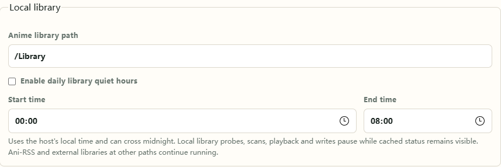

Save the configuration, open a title's details, and check that identified media can be played. For seasonal subscriptions, add one subscription using the next section and check the synchronization result. After verifying playback or a subscription, add further titles.

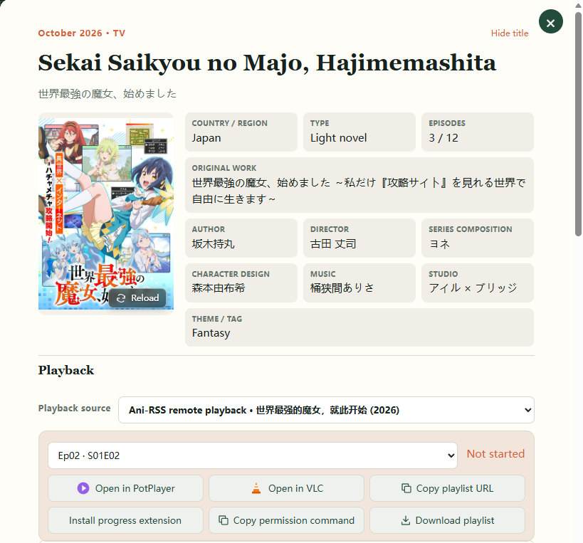

<a id="daily-use"></a>

## 3. Everyday use

### Browse and filter

Switch between cards and a table on the home page. Filter by year, month, format, studio, theme, resource source, or collection status. Search accepts Chinese, Traditional Chinese, English, and Japanese names.

A card's resource and subscription labels describe available releases or subscriptions. Its collection label describes your media holdings. Open details to see individual episodes and files. Use “New Episode Follow-up” to follow updates or “Random” to pick something to watch.


### Release radar and subscriptions

“New Episode Follow-up” and Release radar group titles as TV, films, OVA, web animation, then other types. Within each group, aired titles show recent activity first; upcoming titles follow their expected dates from earliest to latest. Activity uses the later of subscription time and the latest episode resource update.

[Connect Ani-RSS](#ani-rss), then:

1. Open **Release radar** and choose the previous, current, or next season. Each season appears on one page.
2. Click **Sync** to refresh subscriptions, media, and releases for the selected season. **Search** checks the current season in sequence and shows progress immediately. If a title fails, the scan continues; click again to retry unfinished titles.
3. Click **Subscribe** for a title, choose a release or group, and confirm.
4. Ani-RSS handles downloading. You can close the window and keep browsing during submission. Subscription status and media progress sync back automatically.

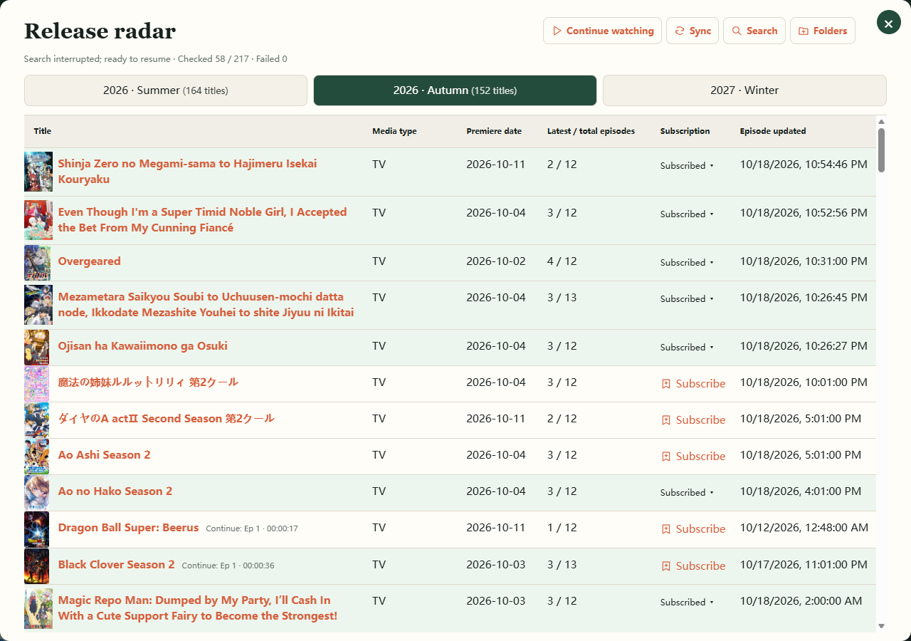

Choose a subtitle group in the subscription window, then click **Enable subscription**. The radar changes to **Subscribed** once the request completes.

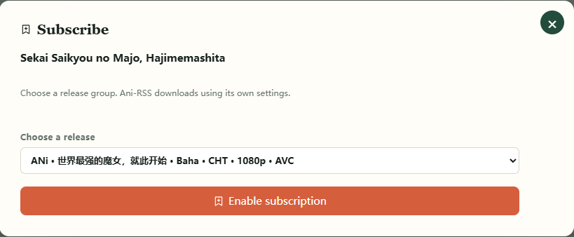

Releases excluded by your language, subgroup, or quality preferences show the reason. To use one, select it in title details, click **Subscribe anyway / Download anyway**, then review and submit the task preview. The radar subscription window also offers **Subscribe anyway**. This applies only to your current selection and does not change your settings.

Films with a BD release this season also appear in the radar, with the BD date below the premiere date. When no explicit BD date is available, the search also checks films that premiered within the past year. Their earliest resource publication reported by Ani-RSS determines the season and appears as a “Release” date.

The latest count in “Latest / total episodes” prioritizes Ani-RSS resource and subscription records. “Episode updated” appears when a timestamp is available. “Start date” combines date and format, for example `2026-10-05 (TV)`. Click a column such as “Start date” to sort the entire season; click again to reverse the order.

Open the Subscribed or Paused menu to pause, resume, or unsubscribe. Unsubscribing keeps downloaded files; deleting the subscription and files has a separate confirmation. New subscriptions move forward within their group, subject to the home page date filters.

The radar’s **Watched episode** column shows your last played episode. Click its number or dash to edit it. Pale green marks new episodes to watch for subscribed titles only; it clears when the latest episode is confirmed finished. Opening details does not clear it.

Choose **Hide title** from a title’s subscription menu to remove it from this account’s radar, title lists, and newly generated Continue watching playlists. Subscriptions and downloads continue. Open **Hidden titles** at the top of the radar to search and restore titles; the home page’s title search can also find them.

### Continue watching

Choose a season in **Release radar**, click **Continue watching**, select the titles you want to watch, then open a player. Use each row’s From and To fields to edit its playback range (for example, change the default 2–4 to 1–4 or 3–4), selecting only playable episodes in that range. Drag title rows to change the order. Only selected titles enter the playlist, from top to bottom; playback buttons stay disabled until you select a title. If media availability or viewing progress changes before you launch playback, reopen the playlist to refresh the playable range. The list includes only subscribed TV titles with new episodes to watch. Each starts with your last played episode and continues to the latest available episode; a new title starts with its earliest available episode. Completed episodes are skipped by default. Other titles remain playable from title details.

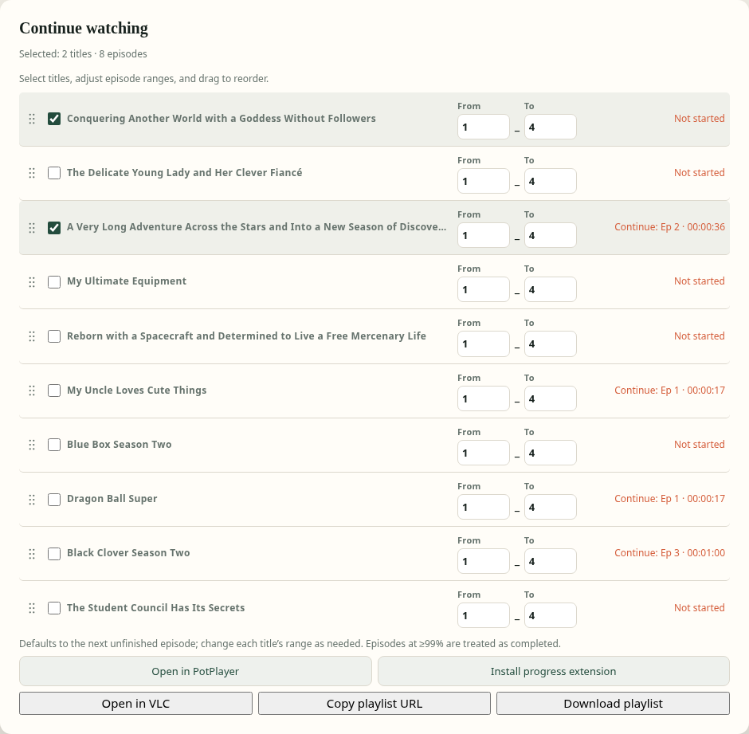

Records belong to your account and are shared by title details and the radar. Click **Watched episode** or **Continue: Ep X** to change the next starting episode or position, watch from the beginning, or undo a change. Subscribed titles with a new episode to watch have a pale green background. It clears when you select **Latest episode finished**, save an episode number higher than the latest release, or the player reports at least 90% playback of the latest episode. **Continue watching** includes only these subscribed TV titles. Opening a playlist does not change the record. The position extension saves precise playback time; playback of 1% or less does not count as watched. With sign-in disabled, all devices share one record.

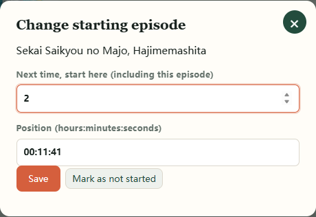

**PotPlayer**: click **Install progress extension** in the playback area. Close the player, merge the ZIP's `Extension` folder into its installation folder, then restart the player. It takes effect automatically. The extension runs inside the 64-bit player and records the actual playback position. Playback resumes five seconds before the last position, or from the beginning if it was under five seconds. Direct launch, copied URLs, and downloaded playlists all work. Without the extension, playlists still play normally and record viewing by episode.

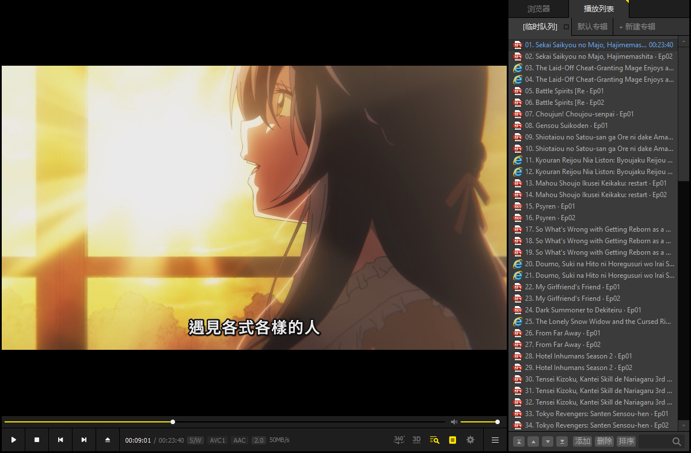

**VLC**: the PotPlayer extension is not needed. AnimeMachine records episodes by default. Resume positions saved locally by VLC are managed by VLC separately from your AnimeMachine account.

If Edge or Chrome on Windows asks for confirmation every time, choose **Copy permission command**, press `Win + R`, enter `cmd`, press Enter, then paste and run the command, then reopen the browser. The command adds PotPlayer and VLC permissions for this site and keeps existing permissions.

If automatic copying is blocked, a dialog shows the full command selected. Press `Ctrl+C`, then paste and run it in `cmd`.

### Fill gaps and download

After connecting qBittorrent, click **Search Torrents** in title details. When the search finishes, the view moves to the release choices. Select one and click **Preview download plan**, then check the files and save location before submitting. Releases with an unconfirmed title match show an explanation and cannot be submitted yet.

**Ani-RSS subscriptions** and **Torrent downloads** have separate sections. Torrents start collapsed and expand after a search. Each subtitle group has a dropdown for platform, subtitles and quality, such as Baha / CR, simplified / traditional Chinese and 1080p / 720p. Choose a version, select the release, then confirm. Ani-RSS uses only that group and version for future releases; changing versions keeps existing files, the save directory and progress.

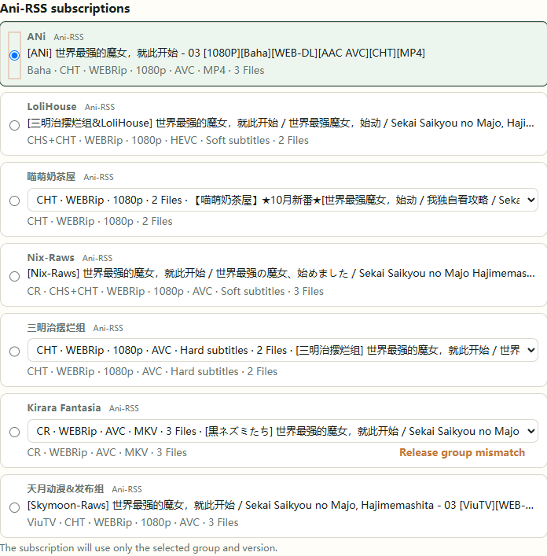

Put existing `.torrent` files in your **Torrent pool** folder. The full Compose stack includes a resource collector that adds files there in the background. **Settings → Connections → Torrent Collector** lets you choose per-work search sources and limits, and control scheduled scans, automatic collection and older-release collection. Admission and ranking follow your existing resource preferences.

Ongoing series are checked for the correct season and consecutive episodes, at most one episode behind the latest known release. Long series use the most recent 24 episodes. Wrong seasons, gaps, and stale versions are filtered out; completed titles and films remain available for collection downloads.

1. Find a title and check candidate releases and existing files in its details.
2. Select the works to collect, generate a plan, and review the files and destination folders.
3. Confirm the plan. Tasks are added to qBittorrent in a **stopped state**.
4. Open qBittorrent and start those tasks. AnimeMachine updates your collection status after downloads finish.

Plans compare releases with existing files and select content to fill gaps. Adjust your preferences under **Settings → Resource priority / Release groups**.

After a single-episode or single-volume task finishes, **Settings → Subscriptions** can track later releases. New matches appear for your confirmation.

### Create subscription folders and verify your library

After connecting a writable library and saving the settings, click **Folders** in Release radar to create placeholder folders for subscribed titles. Existing folders are reused; repeating the operation skips folders already created.

The same action is available under **Settings → General → Library**, alongside **Verify all local resources**. Both run in the background and show progress and results. Completeness is assessed against the files currently present.

Under **Settings → General → Preview folder changes**, review naming, Japanese edition titles, and companion shorts for registered folders, then download the results. The preview only reads existing folders.

### Set local library quiet hours

Storage checks are read-only. Write permissions are confirmed by actual operations such as creating folders or organizing files.

In **Settings → Connections → Local library**, enable daily quiet hours, enter start and end times, and save. Times follow the host device and can cross midnight, such as 23:00 to 08:00.

Local library probes, scans, verification, playback, and writes pause while existing records remain visible. Access resumes after quiet hours. Ani-RSS and external libraries at other paths continue running. Other applications or libraries on the same disk may still wake it.

Keep configuration, databases, and logs on another disk as well, so the media disk can remain idle during quiet hours.

### Relationship graph

Click **Relationship graph** on a card or in details to explore prequels, sequels, movies, and side stories. Drag, zoom, use fullscreen, filter relationship types, or export an image.


### Playback and subtitles

Open title details, choose a media source and starting episode, then select VLC, PotPlayer, or your system player. IINA is also available on macOS. Use **Copy playlist** to open the current playlist in another player.

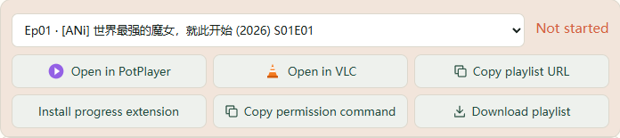

Keep AnimeMachine running during playback. Generate a new playlist after restarting it. Install the player on the device you watch from. For playback on another device, set an AnimeMachine address that device can reach under **Settings → Connections → External player handoff**, such as `http://nas.example:8787`. If the player can access your media share directly, add an SMB / NFS path mapping.

Use embedded subtitles, subtitles alongside your media, or import subtitle files and archives in title details. For online search, enter your ASSRT or OpenSubtitles credentials under **Settings → Connections → Subtitle sources**, then search and select a match.

<a id="connections"></a>

## 4. Connections and folders

<a id="ani-rss"></a>

### Connect an existing Ani-RSS instance

Find the API Key under **Settings → Security** in Ani-RSS. Copy it into **Settings → Connections → Ani-RSS** in AnimeMachine:

| Setting | What to enter |
| --- | --- |
| Service address | An Ani-RSS address reachable from AnimeMachine, such as `http://192.168.1.10:7789` for an instance on a NAS |
| API Key | The key copied from Ani-RSS |
| Mode | “Prefer Ani-RSS” is the usual choice |
| Media path | The Ani-RSS download folder readable by AnimeMachine; leave it empty when using only the remote API |

Inside Docker, `localhost` refers to the container itself. Use `http://ani-rss:7789` within the same Compose stack, or the computer or NAS address for an existing service.

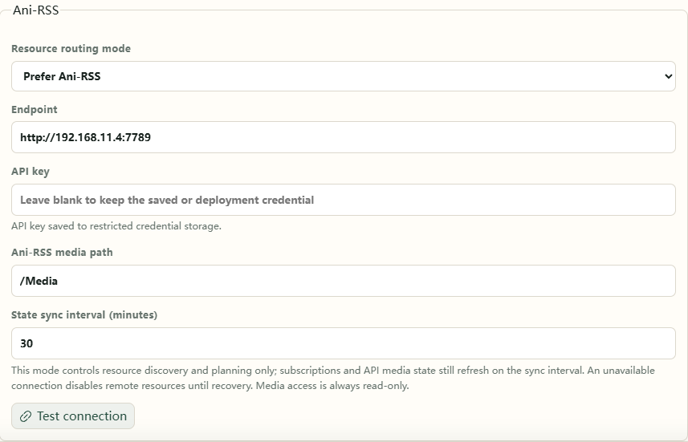

Save, then click **Test connection**. Resources, subscriptions, and media status sync automatically after a successful connection. The full Compose stack configures these connections for you.

Ani-RSS and its downloader should see the same media save path. See the Ani-RSS guides for [download settings](https://docs.wushuo.top/config/download) and [subscriptions](https://docs.wushuo.top/add-rss).

### Connect an existing qBittorrent instance

Use **qBittorrent 5.2.0 or later**. Enable its Web UI in qBittorrent's Web UI settings, then create or copy an API Key.

Under **Settings → Connections → qBittorrent**, enter the service address, API Key, Anime library path, and the library path as seen by qBittorrent. Save and click **Test connection**. A Docker container connecting to a downloader on its host typically uses `http://host.docker.internal:8080`; within the same Compose stack, use `http://qbittorrent:8080`.

<a id="folders"></a>

### Folders and path mapping

A single folder can have different paths on your NAS, inside AnimeMachine, and inside the downloader. **Enter host paths in Compose; enter container paths in the app's settings.**

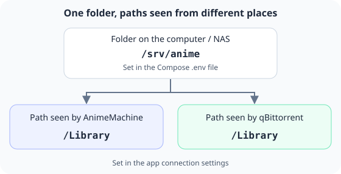

These are the default Compose folders. Relative host paths start from the folder containing `compose.yaml`:

| Host folder | Path inside AnimeMachine | Purpose |
| --- | --- | --- |
| `./library` | `/Library` | New downloads and organized media |
| `./torrents` | `/Torrents` | `.torrent` files |
| `./external/read-only` | `/External` | Browse and play existing media as read-only |
| `./external/ani-rss` | `/Media` | Media downloaded by Ani-RSS |
| `./config`, `./data` | `/Config`, `/Data` | Settings, accounts, and runtime records |

For example, to save your collection in `/srv/anime`, create `.env` beside `compose.yaml` and add:

```dotenv
ANM_LIBRARY_DIR=/srv/anime
```

Run `docker compose up -d` again. The library path in AnimeMachine remains `/Library`. You can change external media and data locations the same way; see [configuration variables](reference.en.md#environment).

On Windows, enter a path such as `D:\Anime` or `\\nas\Anime`. On Linux / macOS, mount your NAS share first, then enter the mount path. Keep settings and runtime data on the machine's local disk; media can live on a NAS. Choose an external read-only library to keep using an existing folder layout.

<a id="maintenance"></a>

## 5. Preferences, updates, and backups

Local videos become playable after the background scan, without renaming existing folders. Ordinary and nested folders are matched using titles and aliases. When several DVD, BD, or release-group editions are available, choose an **Edition** in the title details, then select the starting episode.

Configure local library quiet hours in **Settings → Connections**, using the displayed server time. AnimeMachine leaves that library untouched during quiet hours; Ani-RSS and external libraries at other paths continue to work.

In **Settings → History**, search folder creation, file moves, renames, and removals by path, and restore reversible operations. In **Settings → Logs**, filter warnings and errors, then expand technical details when needed.

For updates, keep the original deployment folder and data. Replace `compose.yaml` there and run `docker compose up -d`. Use `--remove-orphans` only when switching setups and after checking that obsolete services can be removed; existing mounted data is retained.

Choose your language, theme, layout, and browsing filters. Administrators manage folders, connections, resource rules, and users in Settings; regular accounts browse and play media.

AnimeMachine checks Bangumi Archive for catalog updates each week. Use **Settings → General → Check for catalog update** to check immediately, or **Import downloaded catalog base** to use an Archive ZIP you already downloaded. See [network settings](reference.en.md#ANM_CA_BUNDLE) for proxies and custom certificates.

Open **Settings → Updates** to update the app. Read the release notes, then confirm the update. Daily checks and notifications are enabled by default; you can change the check time or choose automatic installation here.

To update a complete Docker image, run the following in the original Compose folder. If your configuration pins a version, change its image tag to your target version first:

```sh
docker compose pull
docker compose up -d
```

To save settings and viewing records as a ZIP, open **Settings → Users → Backup and restore**. Restoring shows a summary before confirmation and restart. See [Backup and restore](manual/en/updates.md).

To move the complete catalog, cache and manual media corrections, stop AnimeMachine and copy:

| Installation | Backup contents |
| --- | --- |
| Windows / Linux / macOS release | `config.json`, `.env.local`, and the entire `data` folder |
| Docker | The Compose file, `.env` if present, and the entire `config` and `data` folders; also back up a custom collector data folder or named volume |
| Both | Keep separate backups of your media and Torrent pool |

To restore, put these files back in their corresponding locations and start with the same configuration. After moving to a new machine, adjust the media paths. Review and restore recorded moves, renames, and version replacements under **Settings → History**.

### Offline updates

In 0.5.1 and later, open **Settings → Updates → Upload offline update**, select the `.anm-update.zip` for your installation, and confirm. Uploading, verification, and installation take place locally. Settings, catalog data, and viewing history are retained.

For Docker 0.5.0 or earlier, first import the offline image:

```sh
docker load -i AnimeMachine-0.5.2-docker-linux-amd64.tar.gz
```

In the original deployment folder, change the AnimeMachine and Torrent Collector image fields (if present) in `compose.yaml` to `animemachine:0.5.2`. Keep mounts and other service settings, then run:

```sh
docker compose up -d --pull never
```

After the page returns, confirm the current version in **Settings → Updates**. Use the same image-import procedure if a later package requires an updated base image.

For Windows, you can also extract the release into a new folder, copy `config.json`, `.env.local` (if present), and the entire `data` folder from the previous installation, then start the new `AnimeMachine.cmd`.

<a id="help"></a>

## 6. Common questions

| Issue | Recommended action |
| --- | --- |
| You forgot the initial password | In a local release or Docker's host data folder, open `data/state/auth/initial-admin.txt`, or check the container logs. The file records the account generated on first launch. |
| The library is empty | Follow initialization progress and wait for title data to import. Check the network and archive status in Diagnostics. |
| Titles appear without covers | Covers load in the background. Keep browsing and check progress in Diagnostics. |
| Existing anime is missing | Check that AnimeMachine's host can read the media folder. In Docker, check the mount and the corresponding container path, such as `/External`. |
| Episode counts or subscriptions are stale | Test the Ani-RSS connection, click **Sync** in Release radar, and check that subscription in Ani-RSS. |
| Not enough reserved disk space | Check the minimum free space in Settings → General → Automation and capacity, then check the disk’s available space. |
| qBittorrent tasks have not started | Check that the plan was submitted, then start its stopped tasks in qBittorrent. |
| The player did not open | Install the player and allow your browser to open external apps. You can also copy the playlist and open it in the player. |
| Playback fails on a phone or another computer | Set an address reachable from that device under External player handoff, and check that it can open AnimeMachine. |
| The port is already in use | Choose another port using the [port settings](reference.en.md#ports), then restart. |

For more detail, open **Settings → Diagnostics / Logs** and check the component's status and recent errors. Background tasks resume retries when the network returns.

For troubleshooting, set `ANM_LOG_LEVEL=DEBUG` before starting to show detailed timings. The default output is sufficient for normal use.
