[中文](guide.md) | [English](guide.en.md) | [日本語](guide.ja.md)  
[README](../README.ja.md) · [アーキテクチャ](architecture.ja.md) · [設定リファレンス](reference.ja.md)

# 導入・利用ガイド

[ユーザーマニュアル](manual/ja/index.md)では、導入から最初の購読、まとめ再生まで順に進められます。アプリ上部の **マニュアル** は同じ内容をオフラインで表示します。このページは日常の操作・設定を素早く確認するためのガイドです。

このガイドでは、導入、初期設定、日常の操作、保守手順を説明します。利用環境に合う起動方法を選び、ログイン後に必要なメディアフォルダーとサービス接続を設定します。

[起動方法](#start) · [初期設定](#first-use) · [日常の使い方](#daily-use) · [接続とフォルダー](#connections) · [更新とバックアップ](#maintenance) · [よくある質問](#help)

<a id="start"></a>

## 1. 起動方法を選ぶ

### Windows

1. [Releases](https://github.com/kyupi-git/animemachine/releases/latest) を開き、Assets から名前が `release-windows.zip` で終わるファイルをダウンロードします。
2. ZIP 全体を `D:\AnimeMachine` など、今後も使うフォルダーに展開します。
3. フォルダー内の **`AnimeMachine.cmd`** をダブルクリックし、起動ウィンドウを開いたままにします。
4. ブラウザーで **<http://localhost:8787>** を開きます。

Python は同梱されています。次回も同じファイルから起動してください。起動ウィンドウを閉じると終了します。

### Linux / macOS

[Python 3.11 以降](https://www.python.org/downloads/)をインストールし、[Releases](https://github.com/kyupi-git/animemachine/releases/latest) から OS とプロセッサーに合うパッケージをダウンロードします。`x86_64` は主に Intel / AMD、`arm64` または `aarch64` は ARM 向けです。Apple シリコンでは ARM 用を選びます。

Linux では展開したフォルダーでターミナルを開き、実行します。

```sh
./AnimeMachine-Linux.sh
```

macOS では **`AnimeMachine-macOS.command`** を開きます。展開したフォルダーのターミナルからも実行できます。

```sh
./AnimeMachine-macOS.command
```

ランチャーが必要なコンポーネントをインストールします。その後、**<http://localhost:8787>** を開いてください。ターミナルを閉じるか、`Ctrl+C` で終了します。実行権限のエラーが出た場合は、先に `chmod +x AnimeMachine*.sh AnimeMachine-macOS.command` を実行します。

<a id="docker"></a>

### NAS / Docker

NAS のアプリ管理で Docker / コンテナ管理を有効にするか、パソコンに [Docker](https://docs.docker.com/get-started/get-docker/) をインストールします。Docker Engine 24 以降、Docker Compose **2.20.3 以降**を使用してください。

[Docker Compose の手順ガイド](../deploy/compose/README.ja.md)を参照してください。通常は[フル構成](https://github.com/kyupi-git/animemachine/blob/main/deploy/compose/compose.yaml)を使います。AnimeMachine、qBittorrent、Ani-RSS、リソース収集サービスをまとめて起動できます。既存サービスがある場合は、下表から代わりの構成を一つ選んでください。01～04 は構成の番号で、作業手順ではありません。

| 利用環境 | 設定ファイル |
| --- | --- |
| 作品を探し、既存のメディアを接続する | [01 · AnimeMachine](https://github.com/kyupi-git/animemachine/blob/main/deploy/compose/templates/01-animemachine-standalone/compose.yaml) |
| qBittorrent をすでに使っている | [02 · 既存のダウンローダーを接続](https://github.com/kyupi-git/animemachine/blob/main/deploy/compose/templates/02-animemachine-external-qbt/compose.yaml) |
| qBittorrent も一緒に導入する | [03 · AnimeMachine + qBittorrent + 収集サービス](https://github.com/kyupi-git/animemachine/blob/main/deploy/compose/templates/03-animemachine-managed-qbt/compose.yaml) |
| ダウンローダー、Ani-RSS、リソース収集をまとめて導入する | [04 · フル構成](https://github.com/kyupi-git/animemachine/blob/main/deploy/compose/templates/04-full-stack/compose.yaml) |

1. `animemachine` など、今後も使うフォルダーを作成します。
2. 表の設定ファイルを開き、**Download raw file** をクリックして、**`compose.yaml`** という名前で保存します。
3. そのフォルダーでターミナルを開き、下記を実行します。NAS の Compose プロジェクト画面では、設定を貼り付けて起動する方法も使えます。

```sh
docker compose up -d
```

4. **`http://NASのアドレス:8787`** を開きます。同じパソコンからなら **<http://localhost:8787>** を使います。
5. コンテナ管理画面で `animemachine` のログを開き、初回のアカウントとパスワードを確認します。ターミナルでは次を実行します。

```sh
docker compose logs animemachine
```

既定のフォルダーと接続は自動で作成されます。03 / 04 は qBittorrent、04 は Ani-RSS も設定済みです。02 を選んだ場合は、[接続の手順](#connections)に沿って既存のダウンローダーを設定してください。

保存先のディスクを指定する場合は、起動前に[フォルダー設定](#folders)に沿って `.env` を追加します。qBittorrent と Ani-RSS は既定で LAN から開けます。アドレスと初回パスワードは[管理画面へのアクセス](reference.ja.md#service-access)を参照してください。

どの構成も `compose.yaml` 一つで起動できます。初回起動時にアカウントとサービス接続を自動設定するため、初期化スクリプトの実行や API キーの入力は不要です。再起動時は既存の設定を引き継ぎます。フル構成では蜜柑と公開作品情報への接続を確認し、公式ソースを優先して、接続できない場合に利用可能な代替ソースを選びます。

<a id="first-use"></a>

## 2. 初期設定

### ログインして作品一覧を確認する

起動ウィンドウやコンテナのログに、アクセス先、初回のユーザー名、自動生成されたパスワードが表示されます。ログイン後は準備の進捗を確認できます。Archive を取得・検証し、今期と最近の作品を準備して、配布パッケージに同梱した今期のカバーを表示します。残りの資料と画像はバックグラウンドで補完します。閲覧・購読・再生は先に利用でき、所蔵フォルダーとローカルのダウンロード計画は資料が揃うと利用できます。中断後は準備を再開し、更新時に既存の完全な作品庫がある場合はそのまま使います。

**設定 → ユーザー → パスワードを変更** から自分のパスワードを変更できます。ほかの人も使う場合は、**設定 → ユーザー** でアカウントを追加します。

### メディアフォルダーの設定と確認

**設定 → 接続** で、目的に合うフォルダーを設定します。

| 用途 | 設定項目 |
| --- | --- |
| 新しくダウンロードする作品を整理する | ローカルライブラリの「アニメライブラリのパス」 |
| 保存済みのアニメを見る | 「外部読み取り専用ライブラリを対応付ける」を有効にし、メディアフォルダーを入力 |
| Ani-RSS で取得したアニメを見る | Ani-RSS のメディアパスを入力。または API 経由のリモート再生を利用 |

Docker ではコンテナから見えるパスを入力します。既定のコレクションは `/Library`、既存メディアは `/External` です。[フォルダーの図](#folders)に具体例を載せています。

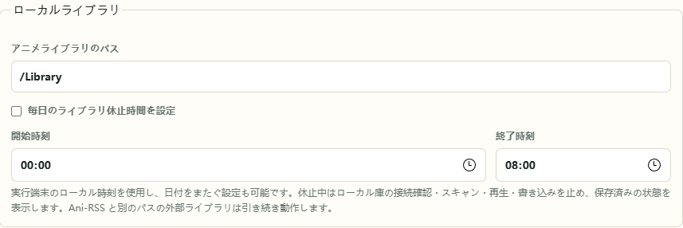

設定を保存して作品詳細を開き、識別されたメディアが再生できることを確認します。新作を購読する場合は、次の手順で購読を一つ追加し、同期結果を確認します。再生または購読の確認後、他の作品を追加します。

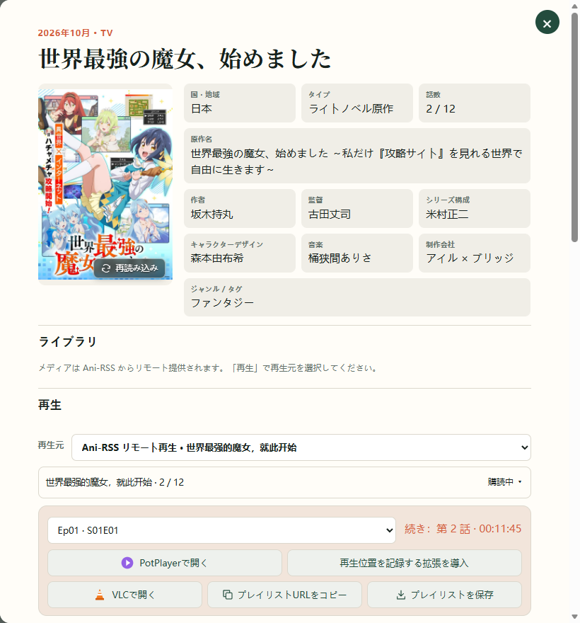

<a id="daily-use"></a>

## 3. 日常の使い方

### 作品を探す・絞り込む

ホーム画面はカードと表を切り替えられます。年代、月、形式、制作会社、テーマ、リソース元、所蔵状況で絞り込めます。中国語、繁体字中国語、英語、日本語の作品名でも検索できます。

カードにはリソースや購読の状態、メディアの所蔵状況が表示されます。詳細を開くと話数やファイルを確認できます。「新作追従」で更新を確認し、「ランダム」で見る作品を選べます。

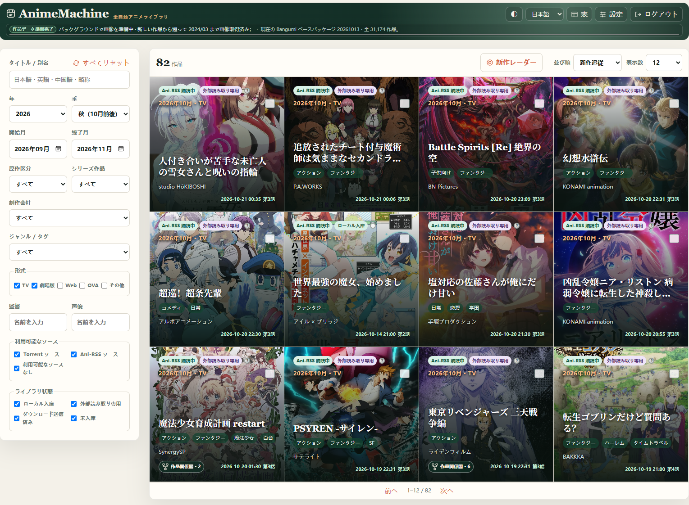

### 新作レーダーと購読

新作追従と新作レーダーは、TV、劇場版、OVA、Web アニメ、その他の順に表示します。同じ種類では、放送済み作品は最近の更新を先に、放送前の作品は開始予定日の早い順に並べます。購読日時と最新エピソードのリソース更新日時のうち、新しい方を使用します。

先に [Ani-RSS を接続](#ani-rss)し、次の順に操作します。

1. **新作レーダー**を開き、前シーズン、今シーズン、次シーズンを選びます。各シーズンの作品は一ページに表示されます。
2. **同期**で購読、メディア、選択中のシーズンのリリース状態を更新します。**検索**は今シーズンの作品を順に検索し、進捗をすぐに表示します。一部の作品で失敗しても検索は続き、再度クリックすると未完了の作品を再検索できます。
3. 追いたい作品の **購読**をクリックし、リリースやグループを選んで確定します。
4. Ani-RSS がダウンロードを行います。登録中は画面を閉じて閲覧を続けられ、購読とメディアの状態が自動で反映されます。

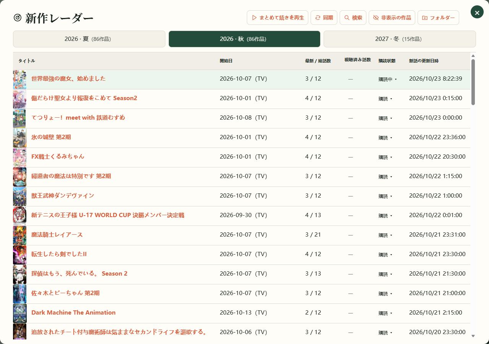

購読画面で字幕グループを選び、**購読を有効化** をクリックします。完了するとレーダーの表示が **購読中** に変わります。

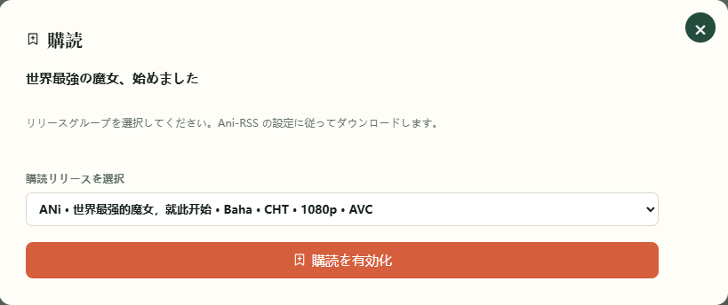

言語、字幕グループ、画質の設定に合わないリソースには理由を表示します。使用する場合は作品詳細で選び、**このリソースで購読 / このリソースでダウンロード** を押して、プレビューを確認してから送信します。レーダーの購読画面でも **このリソースで購読** を選べます。今回の選択にのみ適用され、設定は変更されません。

今シーズンに BD が発売される劇場版も表示され、公開日の下に BD 発売日が付きます。明確な BD 発売日がない場合は、過去一年以内に公開された劇場版も検索します。Ani-RSS が返す最も早いリソース公開日時に基づいてシーズンを判定し、「配布」の日付として表示します。

「最新 / 総話数」の最新話数には、Ani-RSS のリソースや購読記録を優先して使います。新話の更新日時は記録がある場合に表示します。「開始日」は日付と形式を `2026-10-05（TV）` のようにまとめています。「開始日」などの列見出しをクリックすると、シーズン全体を並べ替えられます。もう一度クリックすると逆順になります。

「購読中」「一時停止中」のメニューから、一時停止、再開、購読解除を選べます。購読解除ではファイルを保持し、ファイルを含む削除には別の確認を表示します。新しい購読は同じグループ内で前に移動し、ホーム画面の期間指定も適用されます。

レーダーの **視聴済み話数** は最後に再生した話数です。数字または「—」を押すと変更できます。購読中の作品に未視聴の新着がある場合だけ薄緑色で示し、最新話の視聴完了を確認すると解除します。詳細を開くだけでは変わりません。

作品の購読メニューで **作品を非表示** を選ぶと、現在のアカウントのレーダー、作品一覧、新しく生成する続き再生リストから除外します。購読とダウンロードは継続します。レーダー上部の **非表示の作品** から検索して再表示できます。ホーム画面の作品名検索でも見つけられます。

### まとめて続きを再生

**新作レーダー** でシーズンを選び、**まとめて続きを再生** をクリックします。視聴する作品にチェックを入れ、プレーヤーで開いてください。各行の「開始」「終了」欄で再生範囲を変更できます（既定の 2～4 話を 1～4 話や 3～4 話に変更するなど）。指定範囲内の再生可能な話だけが対象です。作品の行をドラッグして順番を変更できます。選択した作品だけを上から順に再生し、未選択の間は再生ボタンを押せません。再生を開始する前にメディアや視聴進捗が変わった場合は、再生リストを開き直して再生可能な範囲を更新してください。対象は登録中で新着の未視聴話がある TV 作品です。各作品は前回再生した話から最新の再生可能な話までを含み、初回は最も早い話から始まります。視聴済みの話は既定で除外します。他の作品は作品詳細から再生できます。

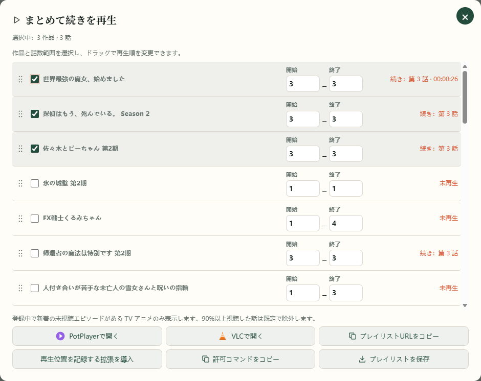

記録はアカウントごとに保存され、作品詳細とレーダーで共有されます。**視聴済み話数**、または **続き：第 X 話** から次回の開始話数や再生位置を変更し、最初からの視聴や変更の取り消しも選べます。登録中の作品に新着の未視聴話があると薄緑色で表示します。**最新話を視聴済みにする**、最新話より大きい話数を保存する、またはプレーヤーから最新話を90％以上再生した記録が届くと解除します。**まとめて続きを再生**は、この状態の登録中の TV アニメだけを対象にします。リストを開くだけでは記録は変わりません。拡張機能で正確な再生位置を保存し、1％以下の再生は視聴として記録しません。ログインを無効にしている場合は全端末で一つの記録を共有します。

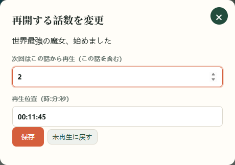

**PotPlayer**：再生欄の **再生位置を記録する拡張を導入** をクリックし、プレーヤーを終了して ZIP 内の `Extension` フォルダーをインストール先に統合します。再起動すると自動で有効になり、64 ビット版プレーヤー内で実際の再生位置を記録し、次回は停止位置の五秒前から再開します。五秒未満の場合は先頭から始めます。直接起動、URL のコピー、リストの保存に対応します。拡張がなくてもリストは通常どおり再生でき、視聴した話数を記録します。

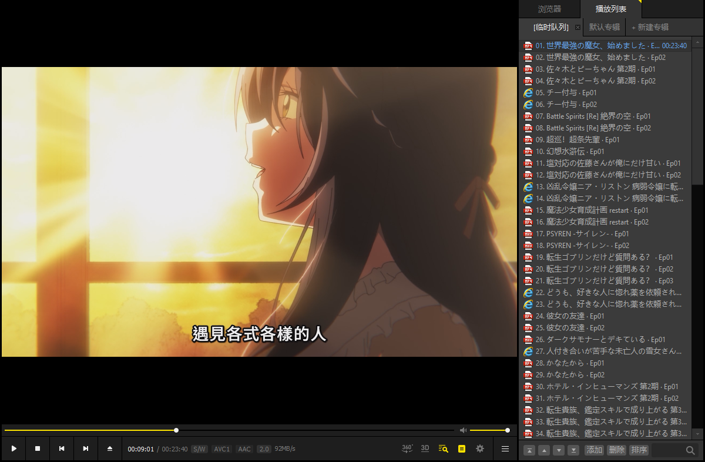

**VLC**：上記の拡張は不要で、標準では視聴した話数を記録します。VLC 自体が端末に保存する再生位置は、AnimeMachine のアカウント記録とは別に管理されます。

Windows の Edge・Chrome で毎回起動の確認が表示される場合は、**許可コマンドをコピー** を押し、`Win + R` で `cmd` を開き、コマンドを貼り付けて一度実行してからブラウザーを開き直します。このサイトから PotPlayer と VLC を起動する許可を追加し、既存の許可も保持します。

自動コピーが拒否された場合は、選択されたコマンド全体がダイアログに表示されます。`Ctrl+C` でコピーしてから、`cmd` に貼り付けて実行してください。

### コレクションを補う・ダウンロードする

qBittorrent の接続後、作品詳細で **Torrent を検索** を押すと、検索後に候補の一覧へ移動します。リリースを選び、**ダウンロード計画を確認** を押して、ファイルと保存先を確認してから送信します。作品との一致が未確認のリリースには理由を表示し、まだダウンロードを送信できません。

**Ani-RSS の購読** と **Torrent のダウンロード** は別々に表示します。Torrent は既定で折りたたみ、検索後に開きます。字幕グループのプルダウンから Baha / CR、簡体字 / 繁体字、1080p / 720p などの配信元・字幕・画質を選び、リソースを選択して確定します。Ani-RSS は以後も選択したグループとバージョンのみを使います。変更時も既存ファイル、保存先、進捗を引き継ぎます。

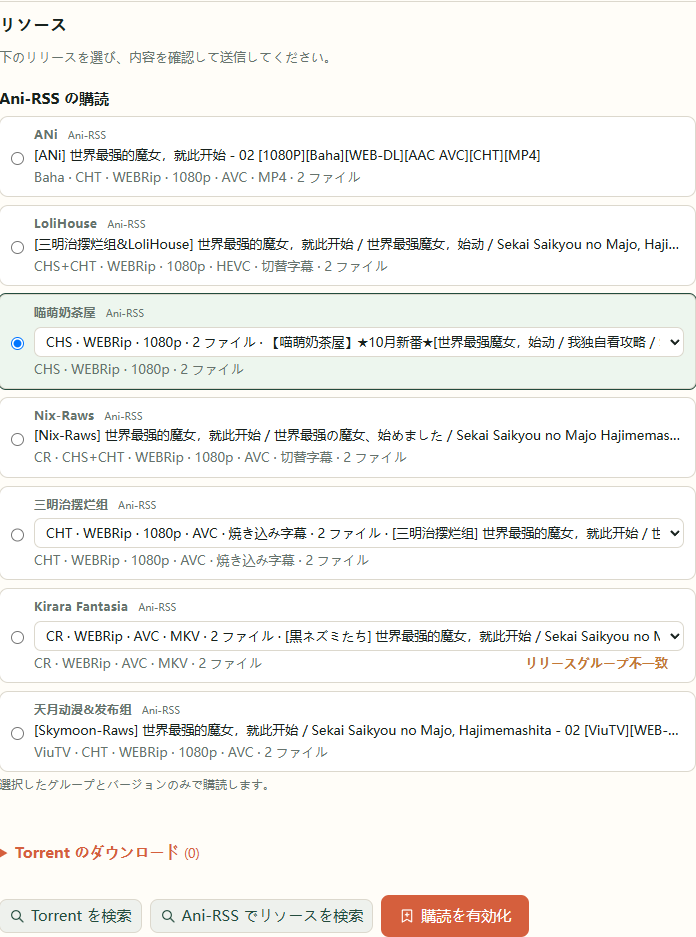

手元の `.torrent` ファイルは **Torrent プール**に入れます。フル Compose 構成では、リソース収集サービスがこのフォルダーにファイルを追加します。**設定 → 接続 → Torrent Collector** では、作品の検索先や件数・制限時間、定期スキャン、自動収集、過去リリースの収集を設定できます。収録と並び順には既存のリソース設定を使います。

放送中の作品はシーズンと話数の連続性を確認し、最新記録から1話までの遅れを許容します。長期連載は直近24話を確認し、別シーズン、欠番、大幅な遅れのある版を除外します。完結作品と劇場版は引き続きコレクションの補完に利用できます。

1. 作品を検索し、詳細で候補リリースと既存のファイルを確認します。
2. 収集したい作品を選んで計画を作り、取得するファイルと保存先を確認します。
3. 確定すると、qBittorrent に**停止状態**でタスクが追加されます。
4. qBittorrent でタスクを選んで開始します。完了後、AnimeMachine が所蔵状況を更新します。

計画では既存ファイルと比較し、不足分を選びます。リソースの好みは **設定 → リソース優先順位 / リリースグループ**で調整できます。

単話・単巻タスクの完了後は、**設定 → 購読**で後続リリースを監視できます。新しい候補が見つかると、確認待ちの項目として表示されます。

### 購読作品のフォルダー作成とライブラリの確認

書き込み可能なライブラリを接続して設定を保存すると、新作レーダーの **フォルダー**から、購読作品の空フォルダーを作成できます。既存のフォルダーを引き継ぎ、繰り返し実行しても作成済みのフォルダーは重複しません。

**設定 → 一般 → ライブラリ**にも同じ操作と **ローカルリソースをすべて確認**があります。処理はバックグラウンドで進み、進捗と結果を表示します。完全性は現在のファイルをもとに評価します。

**設定 → 一般 → フォルダー変更のプレビュー** では、登録済みフォルダーの名前、日本語版タイトル、付属短編の対応を確認して結果を保存できます。プレビューは既存フォルダーの読み取りのみを行います。

### ローカルライブラリの休止時間

ストレージの状態と権限は読み取りのみで確認します。書き込み権限は、フォルダー作成やファイル整理などの実際の操作で確認します。

**設定 → 接続 → ローカルライブラリ**で毎日の休止時間を有効にし、開始・終了時刻を保存します。実行端末のローカル時刻を使用し、23:00 から翌朝 08:00 のように日付をまたぐ指定も可能です。

休止中はローカル庫の接続確認、スキャン、検証、再生、書き込みを止め、保存済みの状態を表示します。終了後はアクセスを再開します。Ani-RSS と別のパスの外部ライブラリは動作を続けます。同じディスクを別のアプリやライブラリが使用すると、ディスクが起動する場合があります。

設定、データベース、ログも別のディスクに保存すると、休止時間中にメディア用ディスクを待機状態に保ちやすくなります。

### 作品関係図

カードや作品詳細の **作品関係図**を開くと、前作、続編、劇場版、番外編などを確認できます。ドラッグ、拡大・縮小、全画面表示、関係の絞り込み、画像の書き出しが使えます。

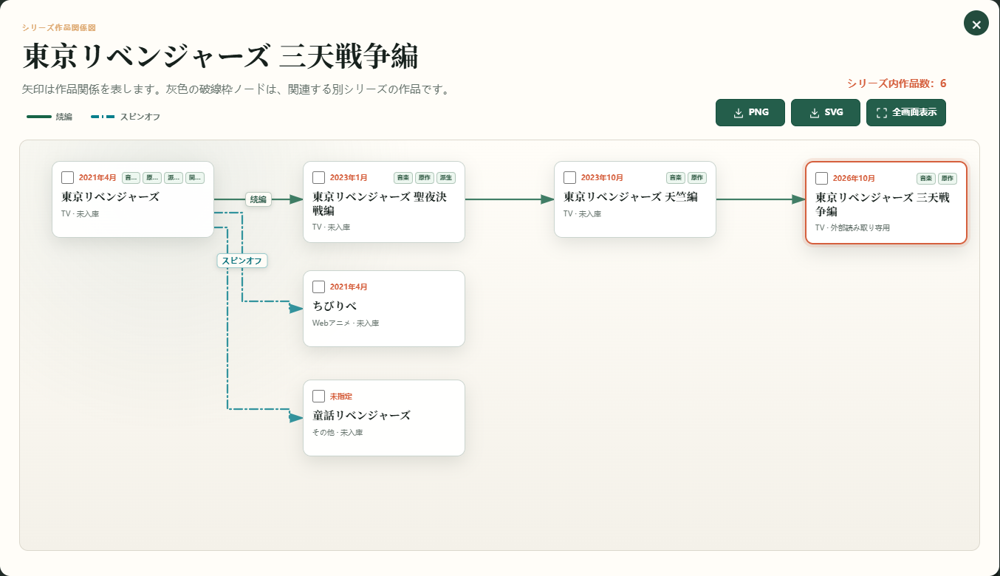

### 再生と字幕

作品詳細で再生元と開始する話を選び、VLC、PotPlayer、システムプレイヤーを開きます。macOS では IINA も使えます。**プレイリストをコピー**すると、シーズン全体を別のプレイヤーで開けます。

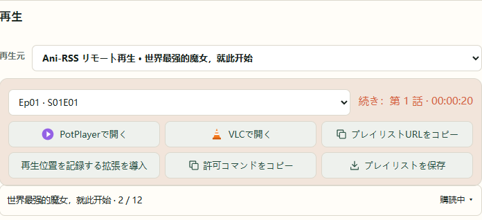

プレイヤーは視聴する機器にインストールしてください。別の機器で再生する場合は、**設定 → 接続 → 外部プレーヤー連携**に、その機器から開ける AnimeMachine のアドレスを設定します。例は `http://nas.example:8787` です。共有メディアへ直接アクセスできる場合は、SMB / NFS のパスマッピングも使えます。

動画内蔵の字幕、同じフォルダーにある外部字幕を使うほか、作品詳細から字幕ファイルや圧縮ファイルを取り込めます。オンライン検索を使う場合は、**設定 → 接続 → 字幕ソース**に ASSRT または OpenSubtitles のキーを設定し、検索結果から字幕を選びます。

<a id="connections"></a>

## 4. 接続とフォルダー

<a id="ani-rss"></a>

### 既存の Ani-RSS を接続する

Ani-RSS の **設定 → セキュリティ**で API Key を確認し、AnimeMachine の **設定 → 接続 → Ani-RSS** にコピーします。

| 項目 | 入力内容 |
| --- | --- |
| サービスアドレス | AnimeMachine から接続できる Ani-RSS のアドレス。NAS 上なら `http://192.168.1.10:7789` など |
| API Key | Ani-RSS からコピーしたキー |
| モード | 通常は「Ani-RSS を優先」 |
| メディアパス | AnimeMachine から読める Ani-RSS の保存先。リモート API のみ使う場合は空欄 |

Docker 内の `localhost` はコンテナ自身を指します。同じ Compose 構成なら `http://ani-rss:7789`、既存サービスならパソコンや NAS のアドレスを指定します。

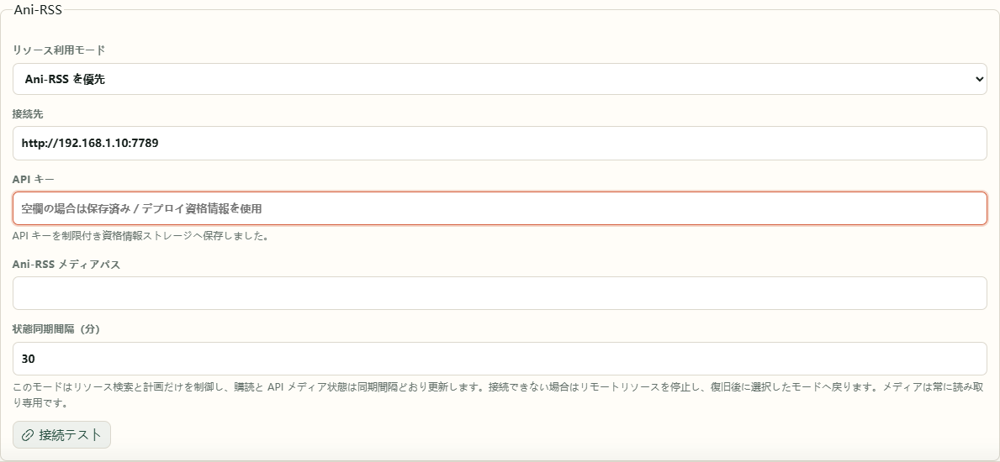

保存して **接続テスト**をクリックします。接続後はリソース、購読、メディアの状態が自動で同期されます。フル Compose 構成では接続済みです。

Ani-RSS とそのダウンローダーには、同じメディア保存先を設定します。細かな項目は Ani-RSS の[ダウンロード設定](https://docs.wushuo.top/config/download)と[購読の説明](https://docs.wushuo.top/add-rss)を参照してください。

### 既存の qBittorrent を接続する

**qBittorrent 5.2.0 以降**を使用します。qBittorrent の Web UI 設定で Web UI を有効にし、API Key を作成またはコピーします。

**設定 → 接続 → qBittorrent** にサービスアドレス、API Key、アニメライブラリのパス、qBittorrent から見えるライブラリのパスを入力します。保存して **接続テスト**をクリックしてください。Docker からホスト側のダウンローダーへ接続する場合は通常 `http://host.docker.internal:8080`、同じ Compose 内なら `http://qbittorrent:8080` を使います。

<a id="folders"></a>

### フォルダーとパスマッピング

同じフォルダーでも、NAS、AnimeMachine、ダウンローダーから見たパスは異なる場合があります。**Compose にはホスト側のパス、アプリの設定にはコンテナ内のパスを入力します。**

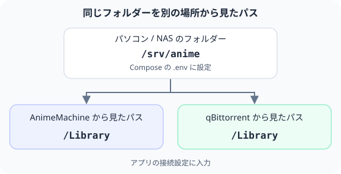

Compose の既定値は次のとおりです。ホスト側の相対パスは、`compose.yaml` のあるフォルダーを基準にします。

| ホスト側のフォルダー | AnimeMachine 内のパス | 用途 |
| --- | --- | --- |
| `./library` | `/Library` | 新規ダウンロードと整理したコレクション |
| `./torrents` | `/Torrents` | `.torrent` ファイル |
| `./external/read-only` | `/External` | 既存メディアを読み取り専用で参照・再生 |
| `./external/ani-rss` | `/Media` | Ani-RSS が取得したメディア |
| `./config`、`./data` | `/Config`、`/Data` | 設定、アカウント、実行記録 |

例えば `/srv/anime` に保存する場合は、`compose.yaml` と同じ場所に `.env` を作り、次を記入します。

```dotenv
ANM_LIBRARY_DIR=/srv/anime
```

`docker compose up -d` を実行します。AnimeMachine のライブラリ設定は `/Library` のままです。外部メディアやデータの保存先も同じ方法で変更できます。[設定変数](reference.ja.md#environment)を参照してください。

Windows で直接動かす場合は `D:\Anime` や `\\nas\Anime` などを指定します。Linux / macOS では NAS 共有をマウントし、そのパスを指定します。設定と実行データはアプリを動かす機器のローカルディスクに置き、メディアは NAS に保存できます。既存のフォルダー構成を使う場合は、外部読み取り専用ライブラリとして接続します。

<a id="maintenance"></a>

## 5. 設定・更新・バックアップ

ローカル動画はバックグラウンド走査後に再生できます。既存フォルダーの改名は不要です。作品名や別名を使って一般的なフォルダーや深い階層を認識します。DVD・BD や複数グループの版がある場合は、作品詳細の **再生バージョン** を選んでから開始エピソードを指定します。

ローカルライブラリの休止時間は **設定 → 接続** で設定します。表示されるサーバー時刻が基準です。休止中はそのライブラリへのアクセスを停止し、Ani-RSS や別のパスにある外部ライブラリは引き続き利用できます。

**設定 → 履歴**では、フォルダーの作成やファイルの移動・名前変更・削除をパスで検索し、元に戻せる操作を復元できます。**設定 → ログ**では警告とエラーを絞り込み、必要に応じて技術情報を開けます。

更新時は元の配置フォルダーとデータを維持し、`compose.yaml` を差し替えて `docker compose up -d` を実行します。別の構成へ切り替える際に不要な旧サービスがあることを確認した場合に限り、`--remove-orphans` を付けます。マウント先のデータは引き継がれます。

言語、テーマ、表示形式、絞り込みは好みに合わせて変更できます。管理者は設定画面でフォルダー、接続、リソース規則、ユーザーを管理し、一般ユーザーは作品の閲覧や再生を行います。

Bangumi Archive の更新は毎週自動で確認します。**設定 → 一般 → カタログベースを確認・更新**からすぐに確認することもできます。ダウンロード済みの Archive ZIP は **ダウンロード済みベースを取り込む**で取り込めます。プロキシや独自証明書は[ネットワーク設定](reference.ja.md#ANM_CA_BUNDLE)を参照してください。

アプリの更新は **設定 → 更新を確認**から行います。説明を読んでから更新を確定します。既定では毎日確認し、新しいバージョンを通知します。確認時刻や自動インストールもここで変更できます。

Docker のイメージ全体を更新する場合は、元の Compose フォルダーで次を実行します。バージョン固定の構成では、先にイメージのタグを更新先のバージョンへ変更してください。

```sh
docker compose pull
docker compose up -d
```

バックアップは AnimeMachine を停止してから、次をコピーします。

| 導入方法 | 保存するもの |
| --- | --- |
| Windows / Linux / macOS のリリース | `config.json`、`.env.local`、`data` フォルダー全体 |
| Docker | Compose ファイル、`.env`（使用時）、`config` と `data` 全体。収集サービス用の独自フォルダーや名前付きボリュームも保存 |
| 共通 | メディアと Torrent プールを別途バックアップ |

復元時は対応する場所に戻し、同じ設定で起動します。別の機器へ移した場合は、その機器のパスに合わせてメディア設定を変更してください。移動、改名、バージョン置換の記録は **設定 → 履歴**から確認・復元できます。

### オフライン更新

0.5.1 以降では、**設定 → 更新を確認 → オフライン更新をアップロード**から、この環境用の `.anm-update.zip` を選んで確定します。アップロード、検証、インストールはローカルで行い、完了後は自動で再起動します。設定、作品情報、視聴履歴は引き継がれます。

Docker の 0.5.0 以前から更新する場合は、先にオフラインイメージを読み込みます。

```sh
docker load -i AnimeMachine-0.5.1-docker-linux-amd64.tar.gz
```

元の配置フォルダーで、`compose.yaml` の AnimeMachine と Torrent Collector（使用している場合）のイメージを `animemachine:0.5.1` に変更します。マウントと他のサービスの設定は維持し、次を実行します。

```sh
docker compose up -d --pull never
```

ページが戻ったら **設定 → 更新を確認**で現在のバージョンを確認します。以後、更新パッケージでベースイメージの更新を求められた場合も、同じ手順でイメージを読み込みます。

Windows では新しいフォルダーへ展開し、旧フォルダーの `config.json`、`.env.local`（存在する場合）と `data` フォルダー全体をコピーして、新しい `AnimeMachine.cmd` を起動する方法も使えます。

<a id="help"></a>

## 6. よくある質問

| 状況 | 対処方法 |
| --- | --- |
| 初期パスワードを忘れた | ローカル導入または Docker のホスト側で `data/state/auth/initial-admin.txt` を確認するか、コンテナのログを開きます。初回に生成したアカウントの記録です。 |
| 作品一覧が空 | 初期化の進捗を確認し、データの取り込みを待ちます。「診断」でネットワークとアーカイブの状態を確認します。 |
| カバーが表示されない | カバーは順次追加されます。作品を探しながら、「診断」で進捗を確認できます。 |
| 保存済みのアニメが見つからない | AnimeMachine を動かす機器からフォルダーを読めるか確認します。Docker ではマウントと `/External` などのパスを確認します。 |
| 話数や購読が更新されない | Ani-RSS の接続をテストし、新作レーダーの **同期** をクリックして、Ani-RSS 側の購読も確認します。 |
| ディスクの予約空き容量が不足する | 設定 → 一般 → 自動化と容量で最低空き容量を確認し、ディスクの空き容量も確認します。 |
| qBittorrent のタスクが始まらない | 計画が送信済みか確認し、qBittorrent で停止中のタスクを開始します。 |
| プレイヤーが開かない | プレイヤーをインストールし、ブラウザーで外部アプリの起動を許可します。プレイリストをコピーして開くこともできます。 |
| スマートフォンや別のパソコンで再生できない | 「外部プレイヤー連携」に視聴機器から開けるアドレスを設定し、AnimeMachine の画面が開くか確認します。 |
| ポートが使用中 | [ポート設定](reference.ja.md#ports)で別の番号に変更し、再起動します。 |

詳しく調べる場合は **設定 → 診断 / ログ**を開き、該当コンポーネントの状態と最近のエラーを確認します。ネットワークが復旧すると、バックグラウンドの再試行が続きます。

詳しい所要時間を調べる場合は、起動前に `ANM_LOG_LEVEL=DEBUG` を設定します。通常は既定の出力で利用できます。
