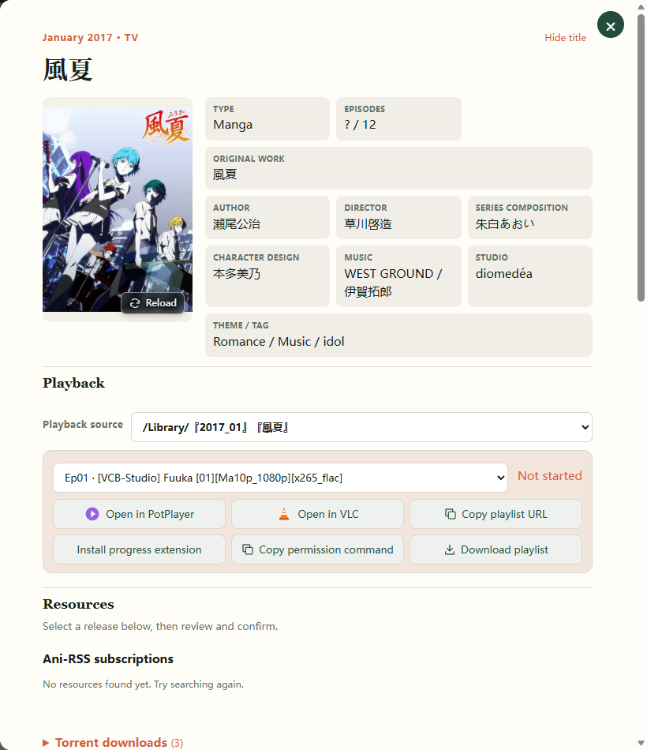
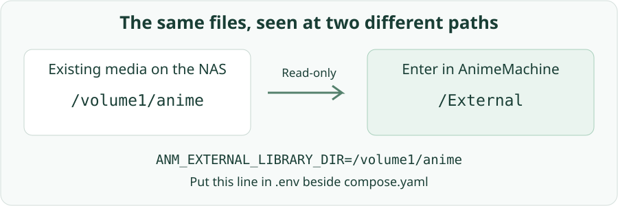
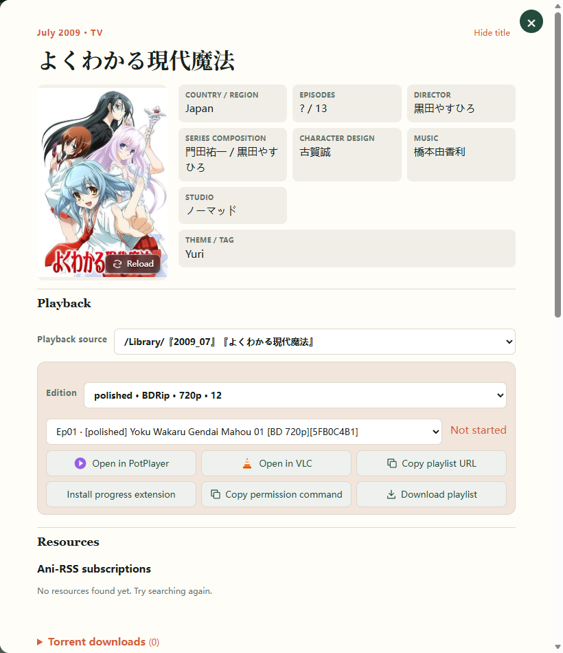
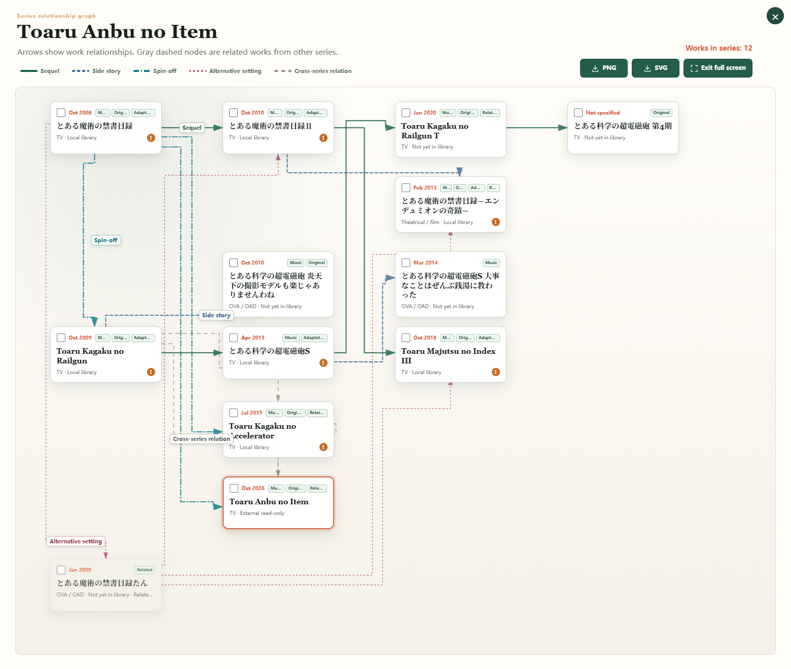

# 7. Existing collections

Connect media already on disk while retaining its folder structure. AnimeMachine recognizes ordinary title folders, nested folders, and collections with DVD, BD, or multiple release groups. Choose the source and edition when playing.

## Choose how to connect

| What you want | Setting |
| --- | --- |
| Browse and play an existing collection in place | **Map external read-only library** |
| Organize new downloads with AnimeMachine | **Anime library path** |
| Use media downloaded by Ani-RSS | Its media folder or remote media access |

For an established collection, start with the read-only connection. Check identification and playback before choosing any organization tasks.

## Add your folder

1. Open **Settings → Connections**.
2. Enable **Map external read-only library** and enter a media folder accessible to the app.
3. Save and let the background inventory complete.
4. Search for one of its titles, open details, and check playback sources and episodes.



Scanning includes subfolders and separates main episodes from extras such as NCOP, NCED, and trailers. Names should identify the title, season, or episode; check the matched title in details when names are ambiguous.

## NAS paths and container paths {#docker-folders}

Docker first mounts a NAS folder into the container; the app settings use the container path. For example:

| Folder on the NAS | Container path | Enter in settings |
| --- | --- | --- |
| `/volume1/anime` | `/External` | `/External` |
| Project's `library` folder | `/Library` | `/Library` |



For the default stack, create `.env` next to `compose.yaml` with your existing media folder:

```dotenv
ANM_EXTERNAL_LIBRARY_DIR=/volume1/anime
```

Run `docker compose up -d` there, then enable the external library in AnimeMachine. Replace `/volume1/anime` with the actual folder shown in your NAS file manager.

On Windows, enter `C:\Anime` or `\\NAS\Anime` directly. Network shares must be accessible to the Windows account running AnimeMachine. Access or quiet-hours status appears below each path; save edited paths before checking them.

## Select an edition

1. Open the recognized title.
2. Choose the media source, then select a release group, DVD/BD format, or quality in the edition dropdown.
3. Check the available episodes and open your player.



**Expected result:** Playback lists the chosen edition's episodes and opens that edition. **Automatic** chooses an available edition for each episode.

## Files are missing from the page

During the initial scan, Playback shows inventory preparation. If files remain missing afterward, check the folder, mount, and readable status in **Settings → Connections**, then review title and episode naming. Quiet hours and temporary disconnections retain the existing inventory; access resumes when the folder is available.

## Explore series relationships

Click **Relationship graph** on a title card to explore prequels, sequels, movies and side stories. The graph opens at the selected title. Click another title to open its details; toggle relationship types, enter full screen or export an image as needed.


