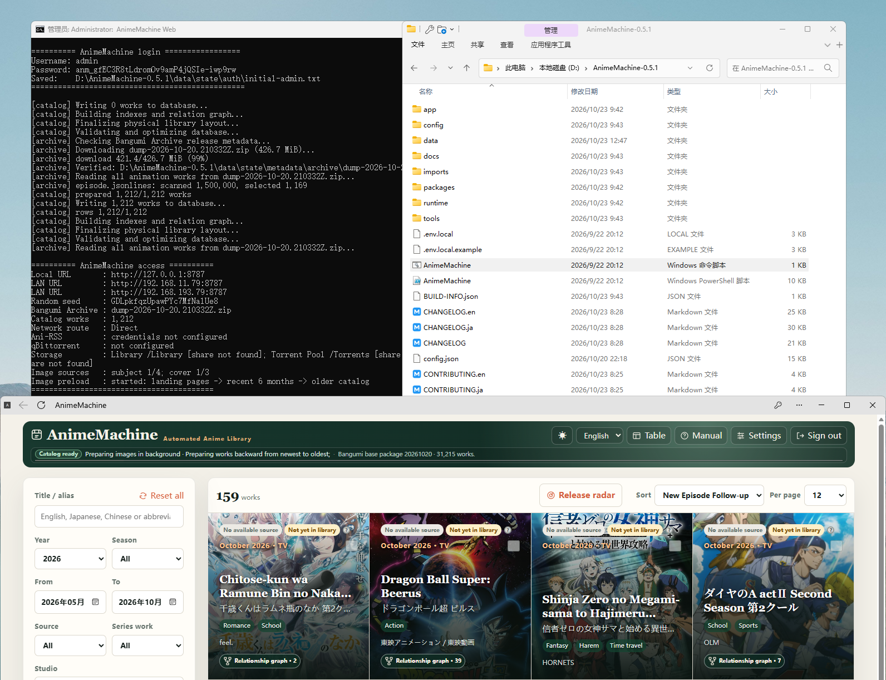

# 1. Desktop setup

This chapter gets AnimeMachine running in your browser. Connect qBittorrent or Ani-RSS when you want downloads; to play files you already have, [add a media folder](collections.md).

## Windows {#windows}

1. Open [Releases](https://github.com/kyupi-git/animemachine/releases/latest) and expand **Assets**.
2. Download the file ending in `release-windows.zip`.
3. Right-click it, choose **Extract All**, and extract it to a permanent folder such as `D:\AnimeMachine`.
4. Open the extracted folder, double-click **`AnimeMachine.cmd`**, and leave the startup window open.
5. Open **<http://localhost:8787>** in your browser.



**Expected result:** the AnimeMachine sign-in page appears. Find the initial username and password in the startup window, then continue to [First login](first-use.md).

The package includes its runtime. Use the same launcher next time. Closing the startup window stops the app.

## macOS / Linux {#macos-linux}

1. Install [Python 3.11 or later](https://www.python.org/downloads/).
2. Download the release for your operating system and processor from [Releases](https://github.com/kyupi-git/animemachine/releases/latest), then extract it.
3. On macOS, open **`AnimeMachine-macOS.command`**. On Linux, open a terminal in the extracted folder and run:

```sh
./AnimeMachine-Linux.sh
```

4. Wait for startup, open **<http://localhost:8787>**, and follow [First login](first-use.md).

| Processor | Release label |
| --- | --- |
| Intel / AMD | `x86_64` |
| Apple silicon or other ARM PCs | `arm64` or `aarch64` |

The launcher installs required components. Leave the terminal open; press `Ctrl+C` to stop. If execution permission is missing, run `chmod +x AnimeMachine-Linux.sh` on Linux or `chmod +x AnimeMachine-macOS.command` on macOS in the extracted folder, then start again.

## Open it from another device

On the same LAN, use the **LAN URL** shown in the startup window, for example `http://192.168.1.20:8787`. On a phone, `localhost` means the phone itself; use the address of the computer running AnimeMachine.

## If something is missing

- **No launcher:** extract the entire ZIP first. Enable file-name extensions in File Explorer to check the name.
- **Page will not open:** keep the startup window running and use its actual port. See [connection checks](troubleshooting.md#open-page).
- **Moving the installation:** stop the app, move the entire folder with `config.json` and `data`, then launch from its new location.
