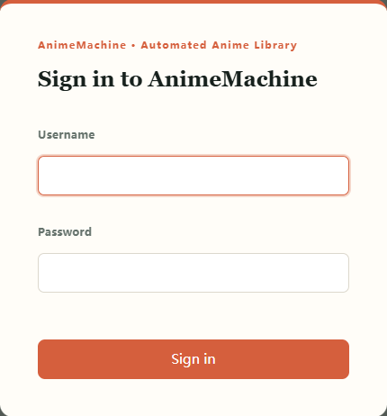
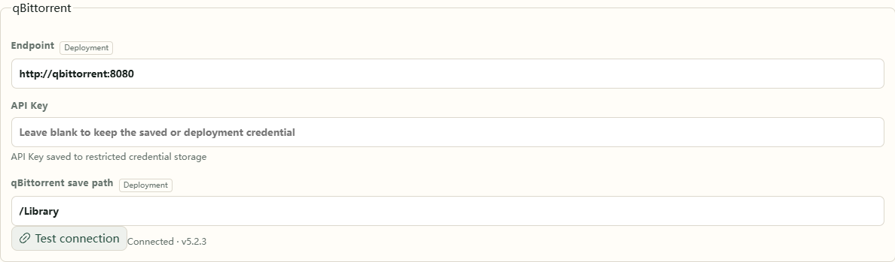

# 3. First login

Sign in, check that titles are available, and confirm where your media will be stored.

## Sign in

1. Open the AnimeMachine address shown in the startup window or container log.
2. Enter the initial username and random password from that window, then choose **Sign in**.
3. Keep the account details. The desktop package also saves them in `data/state/auth/initial-admin.txt`.

Create additional accounts in **Settings → Users**. Viewing records and hidden titles are saved per account, so each household member can keep separate records.

Every account can change its own password. Administrators use **Settings → Users → Change password**; other accounts open **Settings**. Enter the current password and the new password twice. This device stays signed in; use the new password on other devices. Changing the initial password also removes its old saved credential file.

## Let the catalog prepare

The first start downloads and verifies Bangumi Archive, prepares current and recent titles, then fills the remaining catalog in the background. The home-page status shows the current step. Bundled seasonal covers appear when their titles are ready.

Start browsing, subscribing, and playing as titles become available. Historical titles, library organization, and local download plans become available after the complete catalog is ready. If you stop, starting from the same folder resumes preparation.

**Expected result:** title cards appear and open into details. You can use available titles while remaining covers are prepared.

## Check connections

Open **Settings → Connections** and check Ani-RSS and qBittorrent.

- **Default NAS stack:** wait for automatic setup; keys are filled automatically.
- **Desktop or existing services:** enter each service address and credentials, test the connection, then save.
- **Existing media only:** [add your collection](collections.md); connect download services when needed.

Fields marked **Deployment** come from startup settings and show their effective values. Keep them as supplied in the default stack. To connect your own services, set their addresses in the corresponding deployment template.

Your browser opens management pages at `http://NAS-address:port`. Inside the default stack, `http://ani-rss:7789` and `http://qbittorrent:8080` are the addresses used between containers.

## Confirm storage

The default stack already maps `/Library` and `/Media`; keep those defaults to start. To use another disk folder, check the NAS-to-container mapping in [Existing collections](collections.md) first.

Next, [subscribe to one title](subscribe.md) and complete a download.
