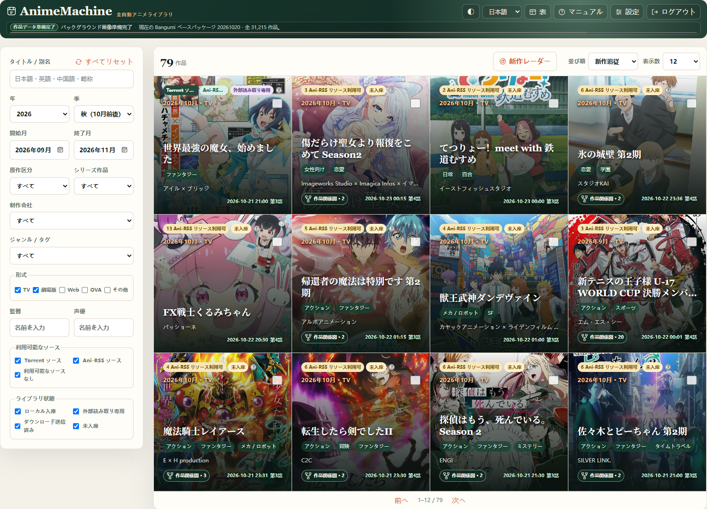

# Start here

AnimeMachine brings title information, subscriptions, existing collections, and player controls into one place. Start with one complete task: find a title, download an episode, and play it. Add your existing collection and adjust other settings afterward.

## Choose where to run it

| Your device | Start with |
| --- | --- |
| Windows PC | [Desktop setup](desktop.md#windows) |
| Linux server or NAS with Docker | [Linux and Docker](docker.md) |
| macOS or Linux PC | [Desktop setup](desktop.md#macos-linux) |
| AnimeMachine is already open | [First login](first-use.md) |

The desktop package runs AnimeMachine; connect download services when needed. The default NAS stack also starts Ani-RSS, qBittorrent, and Torrent Collector, and connects them automatically.

## Complete your first workflow

1. Deploy on your device, then [sign in and check the page](first-use.md).
2. [Subscribe to one title](subscribe.md) and choose a subtitle and release variant.
3. Once an episode is available, [open it in your player](playback.md).
4. Then try [Continue watching](continue-watching.md) or [connect an existing collection](collections.md).

The screenshots illustrate the steps. Available episodes and releases change over time; choose from the current results.

## Follow along

Each chapter covers one task and uses the actual button labels. Click an image to open its full resolution. Switch between 中文, English, and 日本語 at the top of the page.

Skip tasks you have already completed. For a specific problem, use [Troubleshooting](troubleshooting.md) or the notes at the end of the relevant chapter.
