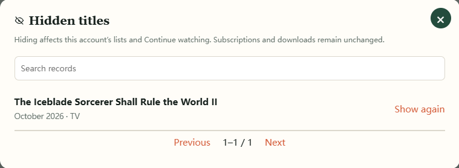
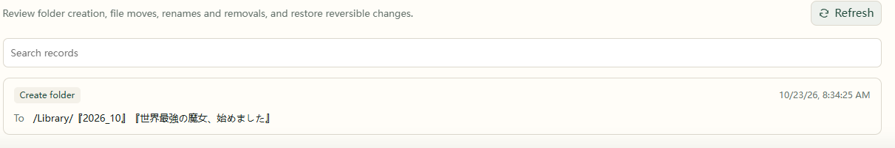

# 8. Daily use

## Find, filter, and hide titles

Switch between cards and a table, and filter by year, type, resource source, or collection status. **Reset all** restores the default filters. A title search can still find titles excluded by defaults or hidden by you.

Set a title to **Hidden** in the radar or details to remove it from default browsing. Its subscription, downloads, and viewing records remain intact.

To restore it, open **Release radar → Hidden titles**, find it, and choose **Show again**.

## Pause, cancel, or delete a subscription

Use the subscription status menu in the radar or title details:

| Action | Later episodes | Existing files |
| --- | --- | --- |
| Pause subscription | Paused; can resume | Kept |
| Cancel subscription, keep files | Subscription stops | Kept |
| Delete subscription and files | Subscription removed | Deleted as described in the confirmation |
| Hide title | Subscription continues | Kept |

For deletion, check the title and file scope in the confirmation before proceeding.

## Create subscription folders

When the local library is connected and writable, **Folders** in the radar creates placeholder folders for subscribed titles. Existing folders are reused; check the result in History.

## Set library quiet hours

1. Open **Settings → Connections → Local library**.
2. Enable daily quiet hours and set their start and end times.
3. Check the server clock shown on the page, then save.

Times follow the device running AnimeMachine and can cross midnight. Local-library access pauses during the interval; cached status remains available and Ani-RSS and other media sources continue independently.

This setting controls AnimeMachine's access. Other applications may still use the disk; physical disk sleep also depends on the NAS and those services.

## Read History and Logs

**Settings → History** lists completed organization, folder, and download operations. **Settings → Logs** shows runtime messages. Filter to warnings and errors, then search by title or keyword.

