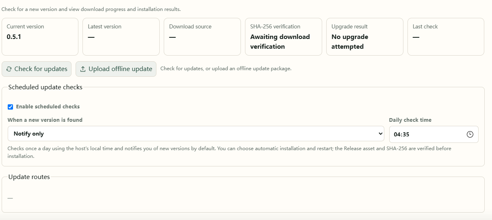

# 9. Updates and backups

App updates retain settings, catalog data, and viewing records. Bangumi Archive is the title-data package and updates separately from the app.

## Online updates

1. Open **Settings → Updates**.
2. Check for a release and read its notes.
3. Use the available update action, wait for the restart, then refresh.
4. Check the running version. Docker users can also redeploy with an updated image.

## Upload an offline update

From 0.5.1, the same page accepts an offline update package:

1. Obtain a matching `.anm-update.zip` on a device that can download it.
2. Select and upload it in **Settings → Updates**.
3. Wait for validation, installation, and restart, then check the version.



| Deployment | Update package |
| --- | --- |
| Windows release | `AnimeMachine-version-windows.anm-update.zip` |
| Docker | `AnimeMachine-version-docker.anm-update.zip` |

The ordinary `release-windows.zip` is a complete installation; the Docker `tar.gz` is an offline image. These differ from upload packages. A mismatched or invalid upload leaves the current working version in place.

## Upgrade Docker 0.5.0 to 0.5.1

Download the offline image from [Releases](https://github.com/kyupi-git/animemachine/releases/latest). Choose `amd64` for Intel/AMD or `arm64` for ARM.

Version 0.5.0 has no upload control. Start with a local image upgrade:

1. Upload `AnimeMachine-0.5.1-docker-linux-amd64.tar.gz` to the NAS. This image is for Intel/AMD; ARM devices need their matching architecture.
2. Import it in a terminal:

```sh
docker load -i AnimeMachine-0.5.1-docker-linux-amd64.tar.gz
```

3. Set `ANM_IMAGE=animemachine:0.5.1` in the project's `.env`. For the default full stack, also set `TORRENT_COLLECTOR_IMAGE=animemachine:0.5.1`.
4. Run `docker compose up -d --pull never` there, refresh, and check the version.

If your custom Compose file hard-codes image names, change the corresponding services' `image` values. Keep mounts, environment settings, and data folders.

## Replace a desktop release manually

Stop the old app and extract the new package into a new folder. Copy `config.json`, `.env.local` if present, and the entire `data` folder from the old installation, then start the new one. Keep separately stored media accessible at its existing path.

## Back up the persistent files

Stop AnimeMachine before backing up settings and `data`. Back up media using your usual storage backup method.

| Deployment | Keep |
| --- | --- |
| Desktop | `config.json`, `.env.local` if present, and `data` |
| Docker | `compose.yaml`, `.env` if present, `config`, `data`, and custom mount settings |

Restore the same mappings and account data. Files such as `initial-admin.txt` and service password files contain account information; keep them with your protected backup.
