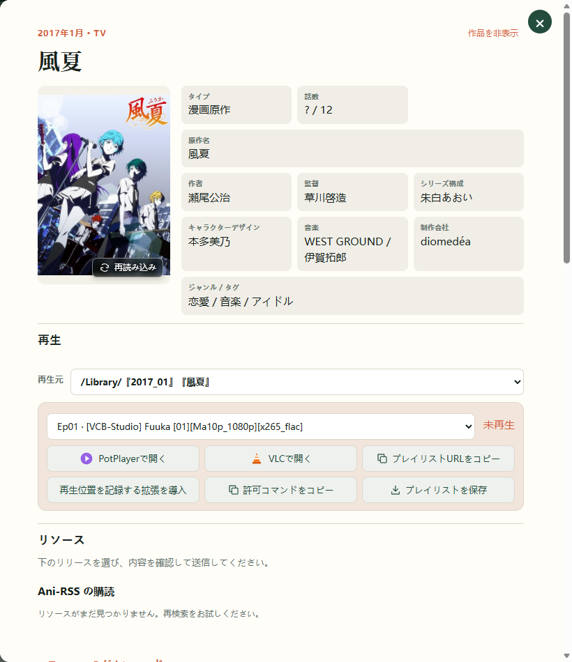
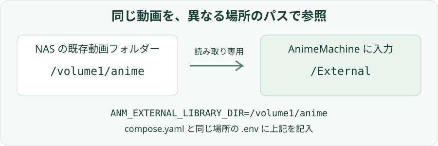
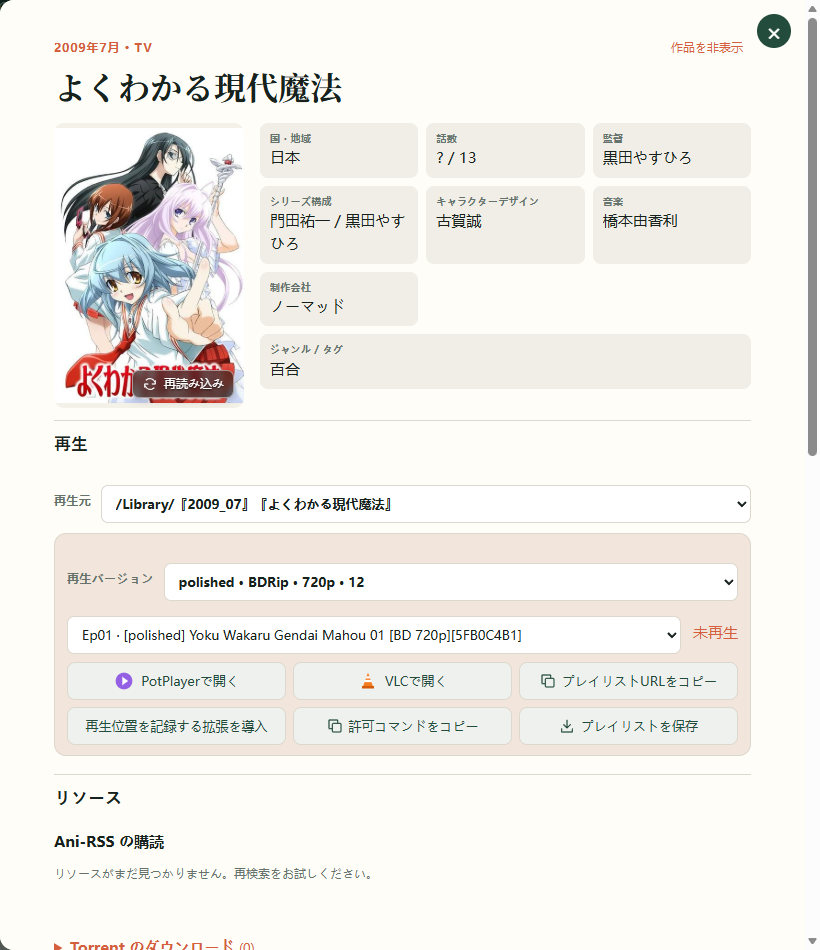

# 7. 既存のコレクション

保存済みの動画は、既存のフォルダー構成を保ったまま接続できます。一般的な作品名フォルダー、深い階層、DVD・BD や複数グループの版を認識し、再生時に再生元と版を選択できます。

## 接続方法を選ぶ

| 目的 | 使用する設定 |
| --- | --- |
| 既存の保存先から閲覧・再生する | **外部の読み取り専用ライブラリをマップ** |
| AnimeMachine で新しいダウンロードを整理する | **アニメライブラリのパス** |
| Ani-RSS で取得した動画を使う | メディアフォルダーまたはリモートメディア機能 |

既存の動画が多い場合は、読み取り専用で接続して認識と再生を確認してから、必要な整理操作を選べます。

## 保存済みのフォルダーを追加する

1. **設定 → 接続** を開きます。
2. **外部の読み取り専用ライブラリをマップ** を有効にし、アプリからアクセスできるフォルダーを指定します。
3. 保存し、バックグラウンドの走査を待ちます。
4. その中の作品を検索し、詳細の再生元と話数を確認します。



走査はサブフォルダーも対象にし、本編と NCOP・NCED・予告などを区別します。作品・シーズン・話数を識別できる名前を使い、曖昧な場合は詳細の対応作品を確認します。

## NAS とコンテナーのパス {#docker-folders}

Docker では先に NAS のフォルダーをコンテナーへマウントし、設定欄にはコンテナー側のパスを入力します。

| NAS のフォルダー | コンテナーのパス | 設定に入力する値 |
| --- | --- | --- |
| `/volume1/anime` | `/External` | `/External` |
| プロジェクトの `library` | `/Library` | `/Library` |



標準構成では `compose.yaml` と同じ場所に `.env` を作り、保存済みの動画フォルダーを指定します。

```dotenv
ANM_EXTERNAL_LIBRARY_DIR=/volume1/anime
```

同じ場所で `docker compose up -d` を実行し、AnimeMachine で外部ライブラリを有効にします。`/volume1/anime` は例なので、NAS のファイル管理画面にある実際のパスへ置き換えます。

Windows では `C:\Anime` や `\\NAS\Anime` を直接指定できます。共有フォルダーは AnimeMachine の実行アカウントからアクセスできる必要があります。各パスの下に読み取り・休止状態を表示します。変更後は保存して確認します。

## 再生する版を選ぶ

1. 認識された作品の詳細を開きます。
2. 再生元を選び、版のプルダウンからグループ、DVD・BD、画質などを選択します。
3. 利用できる話数を確認し、プレーヤーを開きます。



**確認する状態：** 選んだ版の話数が表示され、その版を再生できます。「自動選択」は各話で利用できる版を選びます。

## 保存済みのファイルが表示されない

初回走査中は再生欄に索引の準備状態が表示されます。完了後も不足する場合は **設定 → 接続** でパス・マウント・読み取り状態を確認し、作品名とファイル名を確認します。休止時間や一時的な切断中も索引を保持し、アクセス可能になると再開します。
