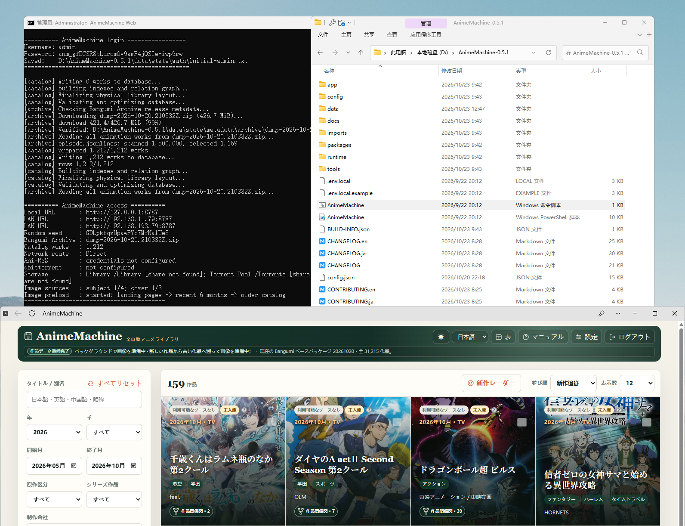

# 1. PC に導入

この章ではブラウザーで AnimeMachine を開くところまで進めます。ダウンロードには後から qBittorrent や Ani-RSS を接続します。手持ちの動画は[メディアフォルダーの追加](collections.md)で利用できます。

## Windows {#windows}

1. [Releases](https://github.com/kyupi-git/animemachine/releases/latest) を開き、**Assets** を展開します。
2. ファイル名が `release-windows.zip` で終わるものをダウンロードします。
3. ZIP を右クリックして **すべて展開** を選び、`D:\AnimeMachine` などの固定フォルダーへ展開します。
4. 展開先の **`AnimeMachine.cmd`** をダブルクリックし、起動ウィンドウを開いたままにします。
5. ブラウザーで **<http://localhost:8787>** を開きます。



**確認する画面：** AnimeMachine のログイン画面が表示されます。初期ユーザー名とパスワードは起動ウィンドウで確認し、[初回ログイン](first-use.md)へ進みます。

実行環境はパッケージに含まれています。次回も同じ起動ファイルを使用します。起動ウィンドウを閉じると停止します。

## macOS・Linux {#macos-linux}

1. [Python 3.11 以降](https://www.python.org/downloads/)をインストールします。
2. [Releases](https://github.com/kyupi-git/animemachine/releases/latest) から OS と CPU に合うパッケージをダウンロードして展開します。
3. macOS は **`AnimeMachine-macOS.command`** を開きます。Linux は展開先でターミナルを開いて実行します。

```sh
./AnimeMachine-Linux.sh
```

4. 起動を待ち、**<http://localhost:8787>** を開いて[ログイン](first-use.md)します。

| CPU | パッケージの表記 |
| --- | --- |
| Intel・AMD | `x86_64` |
| Apple シリコン・その他の ARM PC | `arm64` または `aarch64` |

起動ファイルが必要な構成要素をインストールします。ターミナルを開いたままにし、終了時は `Ctrl+C` を押します。実行権限のエラーが出る場合は、展開先で Linux は `chmod +x AnimeMachine-Linux.sh`、macOS は `chmod +x AnimeMachine-macOS.command` を実行してから再起動します。

## 別の機器から開く

同じ LAN 内のスマートフォンでは、起動ウィンドウの **LAN URL** を使用します。例は `http://192.168.1.20:8787` です。スマートフォンで `localhost` を開くと、そのスマートフォン自身に接続します。

## この手順で困ったら

- **起動ファイルが見つからない：** ZIP 全体を展開してからフォルダーを開きます。エクスプローラーの拡張子表示でファイル名も確認できます。
- **ページが開かない：** 起動ウィンドウが動いているか、表示されたポートと一致しているかを確認します。[接続の確認](troubleshooting.md#open-page)も参照してください。
- **保存先を移したい：** 終了後に `config.json` と `data` を含むフォルダー全体を移動し、新しい場所から起動します。
