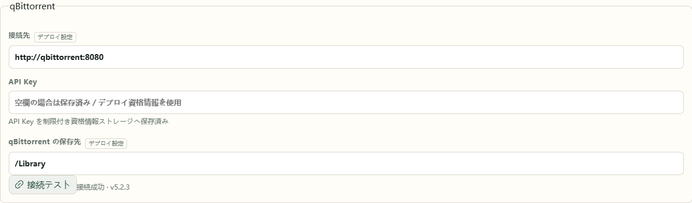

# 3. 初回ログイン

ログインし、作品を表示できることと動画の保存先を確認します。

## ログインする

1. 起動ウィンドウまたはコンテナーログのアドレスを開きます。
2. そこに表示された初期ユーザー名とランダムパスワードで **ログイン** します。
3. アカウント情報を保存します。PC 版では `data/state/auth/initial-admin.txt` にも記録されています。

**設定 → ユーザー** で別のアカウントを作成できます。視聴記録と非表示の作品はアカウントごとに保存されるため、家族も個別の記録を使用できます。

各アカウントは自分のパスワードを変更できます。管理者は **設定 → ユーザー → パスワードを変更**、そのほかのユーザーは **設定** を開きます。現在のパスワードと新しいパスワードを確認用も含めて入力します。この端末はログインを維持し、ほかの端末では新しいパスワードで再ログインします。初期パスワードを変更すると、古い初期認証情報のファイルも削除されます。

## 作品情報の準備を待つ

初回は Bangumi Archive を取得・検証し、今期と最近の作品から準備します。残りはバックグラウンドで補完します。ホームの状態欄に現在の段階が表示され、同梱の今期画像は作品の準備後に利用できます。

作品が表示されたら、検索・購読・再生を先に利用できます。過去の作品、コレクション整理、ローカルダウンロード計画は、全体の資料が揃ってから順次利用できます。中断した場合も同じフォルダーから起動すると再開します。

**確認する画面：** 作品カードが表示され、クリックすると詳細が開きます。残りの画像取得中も表示済みの作品を利用できます。

## サービス接続を確認する

**設定 → 接続** で Ani-RSS と qBittorrent を確認します。

- **標準 NAS 構成：** 自動接続を待ちます。キーの手入力は不要です。
- **PC 版・既存サービス：** アドレスと認証情報を入力し、接続をテストして保存します。
- **手持ちの動画だけを見る：** [コレクションを追加](collections.md)し、ダウンロード用サービスは必要になってから接続できます。

**デプロイ設定** と表示された項目は起動設定から読み込まれ、現在の有効な値が表示されます。標準構成ではそのまま使用できます。既存のサービスに接続する場合は、対応する構成テンプレートでアドレスを指定します。

ブラウザーは `http://NASのアドレス:ポート` を開きます。標準構成内の `http://ani-rss:7789`、`http://qbittorrent:8080` はコンテナー同士が接続するためのアドレスです。

## 保存先を確認する

標準構成には `/Library`、`/Media` などが設定されています。まずはそのまま使えます。別のディスクを使用する場合は、[既存のコレクション](collections.md)で NAS とコンテナーのパスの対応を確認してから変更します。

続いて[作品を購読](subscribe.md)し、最初のダウンロードを確認します。
