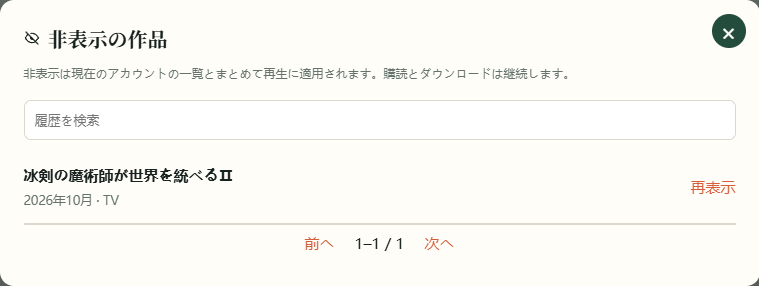
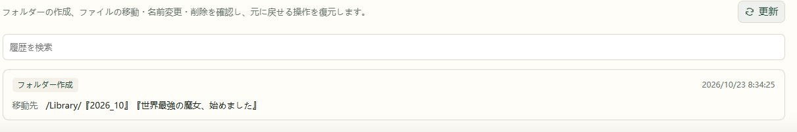

# 8. 日常の管理

## 検索・絞り込み・非表示

ホームはカードと表を切り替え、年代、種類、リソース元、保存状態で絞り込めます。**すべてリセット** で既定に戻ります。タイトル検索では、既定の絞り込み対象外や非表示の作品も見つけられます。

レーダーや詳細で **非表示** にすると通常の一覧から外れます。購読、ダウンロード、視聴記録は保持されます。

戻す場合は **新作レーダー → 非表示の作品** で探し、**再表示** します。

## 購読の一時停止・解除・削除

レーダーの購読状態メニュー、または作品詳細から選びます。

| 操作 | 以降の取得 | 保存済みファイル |
| --- | --- | --- |
| 購読を一時停止 | 一時停止し、再開可能 | 保持 |
| ファイルを保持して購読解除 | 購読終了 | 保持 |
| 購読とファイルを削除 | 購読削除 | 確認画面の対象を削除 |
| 作品を非表示 | 元の購読を継続 | 保持 |

ファイル削除では、確認画面の作品名と対象範囲を確認して実行します。

## 購読用フォルダーを作る

ローカルライブラリが接続済みで書き込み可能な場合、レーダーの **フォルダー** から購読作品の空フォルダーを作成できます。既存フォルダーは再利用し、結果は履歴で確認できます。

## ライブラリの休止時間を設定する

1. **設定 → 接続 → ローカルライブラリ** を開きます。
2. 毎日の休止時間を有効にし、開始・終了時刻を指定します。
3. 画面の実行機器の時刻を確認して保存します。

AnimeMachine の実行機器の時刻を使用し、日付をまたぐ設定も可能です。休止中はローカルライブラリへのアクセスを止め、既知の状態を保持します。Ani-RSS や他の再生元は独立して利用できます。

この設定が制御するのは AnimeMachine のアクセスです。同じディスクを他のアプリが使用する場合、実際のディスク休止は NAS や各サービスの動作にも依存します。

## 履歴とログを読む

**設定 → 履歴** は整理・フォルダー・ダウンロードの操作結果、**設定 → ログ** は動作中のメッセージを表示します。警告・エラーに絞ってから、作品名やキーワードで検索できます。

