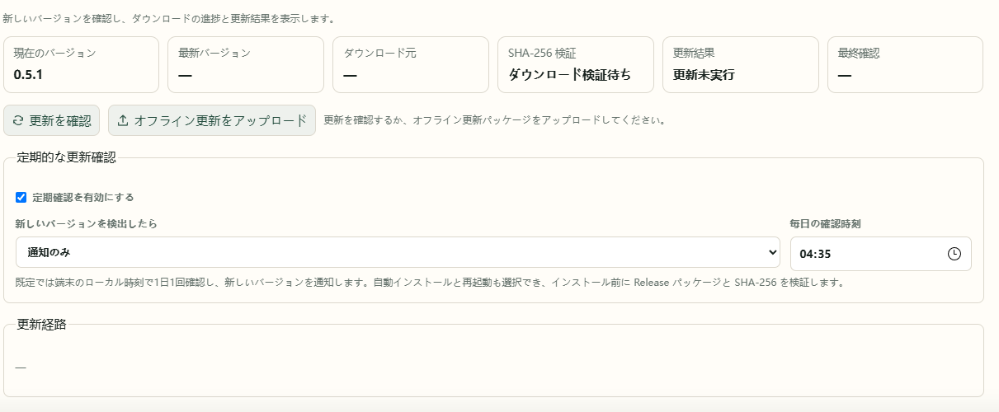

# 9. 更新とバックアップ

アプリを更新しても、設定・作品情報・視聴記録は引き継ぎます。Bangumi Archive は作品資料で、アプリのバージョンとは別に更新します。

## オンライン更新

1. **設定 → 更新の確認** を開きます。
2. 新しいバージョンと変更内容を確認します。
3. 画面で利用できる更新操作を実行し、再起動を待って画面を更新します。
4. 実行中のバージョンを確認します。Docker は新しいイメージによる再作成でも更新できます。

## オフライン更新パッケージをアップロードする

0.5.1 以降は同じページからアップロードできます。

1. ダウンロード可能な機器で、導入方法に対応する `.anm-update.zip` を取得します。
2. **設定 → 更新の確認** でファイルを選んでアップロードします。
3. 検証・インストール・再起動を待ち、バージョンを確認します。



| 導入方法 | 更新パッケージ |
| --- | --- |
| Windows 版 | `AnimeMachine-バージョン-windows.anm-update.zip` |
| Docker | `AnimeMachine-バージョン-docker.anm-update.zip` |

通常の `release-windows.zip` は展開用の完全パッケージ、Docker の `tar.gz` はオフラインイメージです。アップロード用とは用途が異なります。形式や検証結果が不正な場合は、現在のバージョンを引き続き使用します。

## Docker 0.5.0 からのオフライン更新

オフラインイメージは [Releases](https://github.com/kyupi-git/animemachine/releases/latest) から取得できます。Intel / AMD は `amd64`、ARM は `arm64` を選びます。

0.5.0 にはアップロード欄がないため、先にローカルイメージから更新します。

1. `AnimeMachine-0.5.2-docker-linux-amd64.tar.gz` を NAS へ転送します。Intel・AMD 用のため、ARM 機器は対応するイメージを選びます。
2. ターミナルで読み込みます。

```sh
docker load -i AnimeMachine-0.5.2-docker-linux-amd64.tar.gz
```

3. プロジェクトの `.env` に `ANM_IMAGE=animemachine:0.5.2` を設定します。標準のフル構成は `TORRENT_COLLECTOR_IMAGE=animemachine:0.5.2` も指定します。
4. 同じ場所で `docker compose up -d --pull never` を実行し、ページとバージョンを確認します。

独自の Compose にイメージ名を直接指定している場合は、対象サービスの `image` を変更します。マウント、環境設定、データの場所は引き継ぎます。

## PC 版を手動で置き換える

旧版を終了し、新版を別フォルダーへ展開します。旧版の `config.json`、`.env.local`（ある場合）、`data` 全体を新しいフォルダーへコピーして起動します。動画を別の場所に保存している場合は、同じパスを引き続き使用します。

## バックアップの保存と復元

**設定 → ユーザー → バックアップと復元** で **バックアップを保存** をクリックし、ZIP を保存します。設定、アカウント、リリース追跡、視聴記録が含まれます。動画と作品データベースは含まれません。

復元時は **バックアップを復元** から ZIP を選び、バージョンと記録件数を確認して **復元して再起動** をクリックします。再起動後はバックアップ内のアカウントでログインし、接続先と動画フォルダーを確認します。配置時に環境変数で指定した設定は引き続き優先されます。

バックアップにはアカウントと接続情報が含まれるため、自分の端末で保管してください。作品データベース全体の移行や手動識別の保存には、以下のデータフォルダーもバックアップします。

## バックアップするもの

AnimeMachine を停止してから設定と `data` をバックアップします。動画は普段の保存先のバックアップ方法を使用します。

| 導入方法 | 保管するもの |
| --- | --- |
| PC 版 | `config.json`、`.env.local`（ある場合）、`data` |
| Docker | `compose.yaml`、`.env`（ある場合）、`config`、`data`、独自のマウント設定 |

復元時は同じ対応パスとアカウントデータを使用します。`initial-admin.txt` やサービスのパスワードファイルもアカウント情報として保管します。
