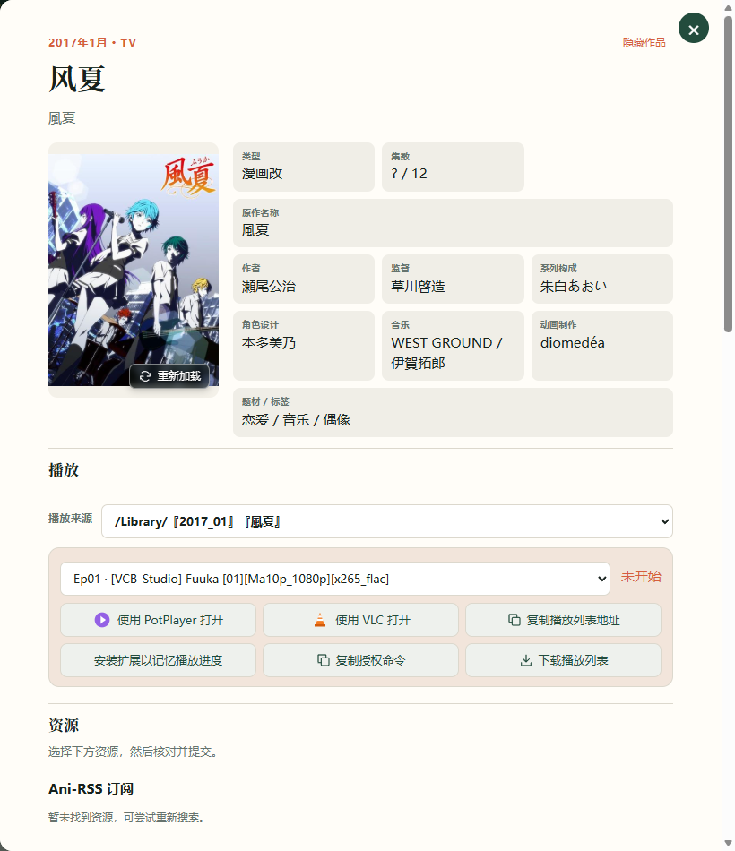
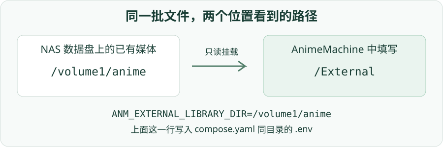
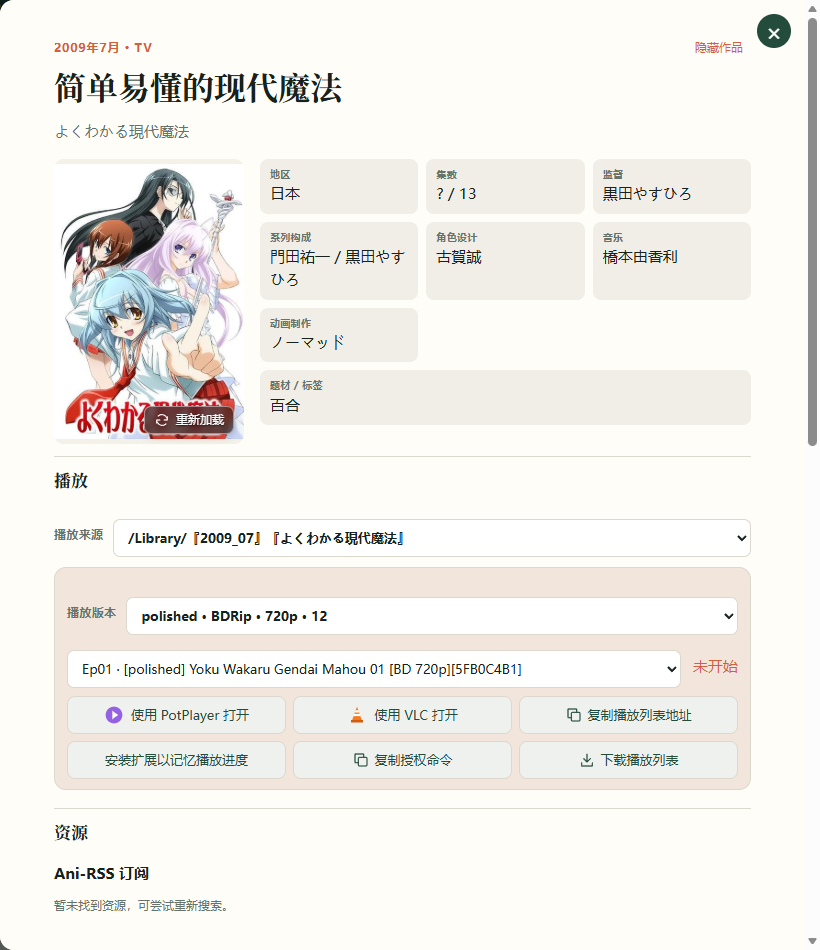

# 7. 使用已有收藏

硬盘上已经有动画时，可以保留现有目录结构接入 AnimeMachine。普通标题目录、较深的子目录，以及 DVD / BD、多资源组并存的收藏都可识别；播放时按作品选择来源和版本。

## 先选择接入方式

| 想实现什么？ | 使用的设置 |
| --- | --- |
| 浏览和播放现有收藏，保留原有目录 | **映射外部只读媒体库** |
| 让 AnimeMachine 整理新下载的收藏 | **动画收藏库路径** |
| 查看 Ani-RSS 下载的媒体 | Ani-RSS 的媒体目录或远程媒体功能 |

已有大量媒体时，可先以外部只读方式接入，确认识别和播放结果后，再考虑需要的整理操作。

## 添加已有媒体目录

1. 打开 **设置 → 连接**。
2. 启用 **映射外部只读媒体库**，填写程序能访问的媒体目录。
3. 保存设置，等待后台完成文件清点。
4. 搜索其中一部作品，打开详情，在播放区查看来源与集数。



扫描会进入子目录，区分正片与 NCOP / NCED、预告等特典。目录或文件名应包含可辨认的作品名称、季度或集数；信息不足时可在详情核对识别结果。

## Docker 的两种路径 {#docker-folders}

Docker 需要先把 NAS 目录挂入容器，再在设置中填写容器路径。例如：

| NAS 上的目录 | 容器看到的目录 | 设置中填写 |
| --- | --- | --- |
| `/volume1/anime` | `/External` | `/External` |
| 项目内 `library` | `/Library` | `/Library` |



默认组合可在 `compose.yaml` 同目录新建 `.env`，填写已有媒体目录：

```dotenv
ANM_EXTERNAL_LIBRARY_DIR=/volume1/anime
```

然后在该目录运行 `docker compose up -d`，再到 AnimeMachine 中启用对应的外部媒体库。`/volume1/anime` 是示例，需要替换成 NAS 文件管理器中真实的目录。

Windows 可直接填写 `C:\Anime` 或 `\\NAS\Anime`；网络共享需要能被运行 AnimeMachine 的 Windows 账号访问。路径下方显示读取或休眠状态，改动后先保存再检查。

## 选择播放版本

1. 打开已识别作品的详情。
2. 先选择媒体来源，再在版本下拉框选择资源组、DVD / BD、画质等版本。
3. 核对可播放的集数，点击播放器按钮。



**完成标志：** 播放区显示该版本的集数，播放器打开选定版本。选择“自动选择”时由程序为各集选择合适的可用版本。

## 未显示已有文件

首次扫描期间，播放区会显示索引准备状态。若扫描结束后仍缺少文件，先检查 **设置 → 连接** 中的路径、挂载与可读状态，再核对作品标题和文件命名。磁盘休眠或暂时断线时，已有索引会保留，恢复可访问后继续使用。

## 查看作品关系

点击作品卡片上的 **作品关系图**，查看前作、续作、剧场版和番外。打开后会定位到当前作品；点击图中标题可打开详情。关系类型可切换显示，也可全屏查看或导出图片。


