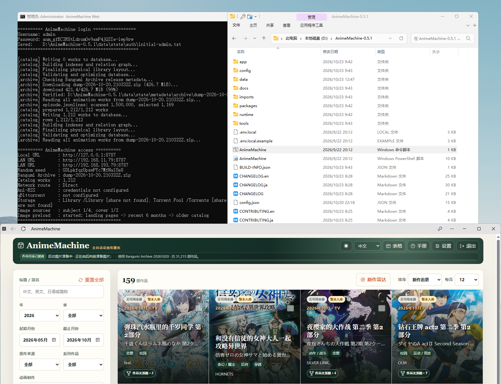

# 1. 电脑部署

本章完成后，可以在浏览器打开 AnimeMachine。下载动画时再连接 qBittorrent 或 Ani-RSS；播放电脑上已有的动画可直接[添加媒体目录](collections.md)。

## Windows {#windows}

1. 打开 [Releases](https://github.com/kyupi-git/animemachine/releases/latest)，展开 **Assets**。
2. 下载名称以 `release-windows.zip` 结尾的文件。
3. 右键 ZIP，选择 **全部解压缩**，解压到固定目录，例如 `D:\AnimeMachine`。
4. 打开解压后的文件夹，双击 **`AnimeMachine.cmd`**，保留启动窗口。
5. 在浏览器打开 **<http://localhost:8787>**。



**完成标志：** 出现 AnimeMachine 登录页面。用户名和初始密码位于启动窗口；接下来阅读[首次打开](first-use.md)。

发布包包含运行环境。后续仍从同一目录双击 `AnimeMachine.cmd` 启动；关闭启动窗口即可停止。

## macOS / Linux {#macos-linux}

1. 安装 [Python 3.11 或更新版本](https://www.python.org/downloads/)。
2. 在 [Releases](https://github.com/kyupi-git/animemachine/releases/latest) 下载与系统和处理器对应的发布包并解压。
3. macOS 双击 **`AnimeMachine-macOS.command`**。Linux 在解压目录打开终端，运行：

```sh
./AnimeMachine-Linux.sh
```

4. 等待启动完成，打开 **<http://localhost:8787>**，按[首次打开](first-use.md)登录。

| 处理器 | 发布包中的标识 |
| --- | --- |
| Intel / AMD | `x86_64` |
| Apple 芯片、ARM 电脑 | `arm64` 或 `aarch64` |

启动器会安装所需组件。保留终端窗口，按 `Ctrl+C` 停止。遇到执行权限提示时，Linux 运行 `chmod +x AnimeMachine-Linux.sh`，macOS 运行 `chmod +x AnimeMachine-macOS.command`，再重新启动。

## 从其它设备访问

电脑与手机连接同一局域网时，手机浏览器使用启动窗口列出的 **LAN URL**，例如 `http://192.168.1.20:8787`。`localhost` 指正在操作的设备，在手机中使用它会访问手机自身。

## 本步常见问题

- **找不到启动文件：** 先完整解压 ZIP，再进入解压后的目录；在资源管理器中启用“显示文件扩展名”可核对文件名。
- **网页打不开：** 检查启动窗口是否仍在运行，按窗口实际显示的端口访问。[连接问题](troubleshooting.md#open-page)提供后续检查顺序。
- **想更换安装目录：** 停止程序后移动整个目录，保留 `config.json` 和 `data`，再从新目录启动。
