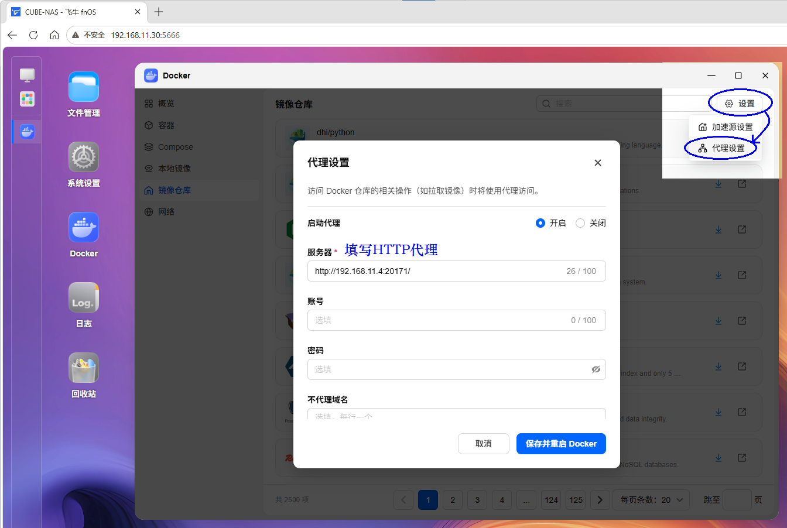

# 2. NAS 联合部署

默认组合一次部署四个服务：AnimeMachine 提供操作页面，Ani-RSS 负责订阅，qBittorrent 下载媒体，Torrent Collector 提供 Torrent 检索。首次启动自动建立连接和账户，后续在 AnimeMachine 中操作即可。

## 准备项目目录

1. 在 NAS 的应用中心安装并打开 **Docker / 容器管理**。终端部署使用 Docker Engine 24+、Compose 2.20.3+。
2. 在 NAS 的数据盘上新建固定目录，例如 `docker/animemachine`，并确认有足够的可用空间。
3. [下载 compose.yaml](../../../deploy/compose/compose.yaml)，保存到这个目录。在 GitHub 文件页面可点击 **Download raw file**。保存后的完整文件名为 **`compose.yaml`**。

默认会在项目目录内建立 `config`、`data`、`library`、`torrents` 和 `external` 等目录。下载的动画存放在 `library` 或 `external/ani-rss`；因此应把项目建在有足够空间的磁盘上。

## 飞牛等 NAS 的图形化部署

1. 在 Docker 应用中进入 **Compose / 项目**，创建名为 `animemachine` 的项目。
2. 项目路径选择刚才新建的目录。
3. 导入 `compose.yaml`，或打开该文件，将全部内容粘贴到项目编辑器。
4. 启动项目，等待镜像下载与容器启动。

界面名称可能随 NAS 系统版本变化；需要指定的始终是**项目名称、项目路径和同一个 Compose 文件**。

## 使用终端部署

已在项目目录打开终端时，运行：

```sh
docker compose up -d
```

查看状态：

```sh
docker compose ps
```

**完成标志：** 四个服务处于运行状态。Ani-RSS 和采集器会等待 AnimeMachine 启动就绪；首次拉取镜像时，项目页面会持续显示下载进度。

## 打开页面并获取密码

1. 在电脑浏览器打开 **`http://NAS地址:8787`**，例如 `http://192.168.1.20:8787`。
2. 在容器管理页面选择 **animemachine → 日志**，找到首次登录用户名和随机密码。
3. 用该账户登录，继续[首次打开](first-use.md)。

终端中可使用：

```sh
docker compose logs animemachine
```

| 页面 | 局域网地址 |
| --- | --- |
| AnimeMachine | `http://NAS地址:8787` |
| Ani-RSS | `http://NAS地址:7789` |
| qBittorrent | `http://NAS地址:8080` |

日常使用 AnimeMachine 即可。若要打开后两个管理页面，用户名为 `admin`；初始密码分别保存在项目目录的 `config/ani-rss/.animemachine/web-password`、`config/qbittorrent/.animemachine/web-password`。

## 已有下载服务或指定媒体目录

已有 Ani-RSS / qBittorrent 时，可改用 [01 或 02 模板](https://github.com/kyupi-git/animemachine/tree/main/deploy/compose/templates)，再在 **设置 → 连接** 中填写已有服务地址。默认文件与模板是替代方案，选一个部署即可。

需要使用其它磁盘目录时，按[已有收藏](collections.md#docker-folders)设置目录映射。完整组合会自动检查公开资源来源的连接情况，并在需要时选择可用备用来源。

## 本步常见问题

- **显示“找不到配置文件”：** 在保存 `compose.yaml` 的目录运行命令，并核对文件没有被保存为 `compose.yaml.txt`。
- **镜像下载失败：** 查看 NAS Docker 的具体错误，恢复下载后再次执行同一启动命令，已下载的层会继续使用。
- **端口已被占用：** 在同目录 `.env` 中设置空闲端口，如 `ANM_WEB_PORT=8788`，再运行 `docker compose up -d`，访问地址也改用 8788。
- **只想暂停使用：** 在项目页面停止项目，或运行 `docker compose stop`。配置、记录和媒体仍保存在项目目录。

如果镜像仓库连接失败，且已有可用的 HTTP 代理，可在飞牛 **Docker → 设置 → 代理设置** 中填写自己的代理地址，再重试部署。这一设置用于拉取镜像；网络可正常访问镜像仓库时，可保持关闭。


