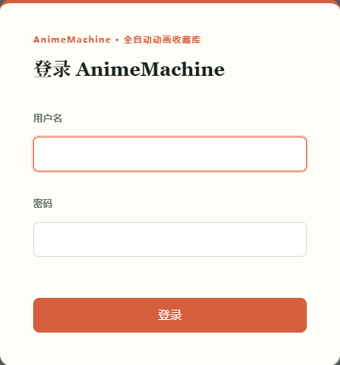
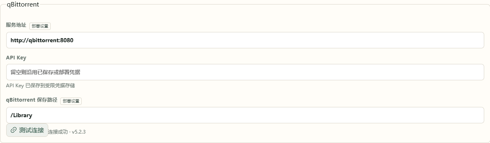

# 3. 首次打开

本章完成后，确认能够登录、浏览作品，并知道媒体将保存在哪里。

## 登录

1. 打开启动窗口或容器日志显示的 AnimeMachine 地址。
2. 输入同一窗口中的初始用户名和随机密码，点击 **登录**。
3. 保存登录信息。电脑部署的初始账户同时保存在 `data/state/auth/initial-admin.txt`。

在 **设置 → 用户** 中可以创建其它账户。观看记录和隐藏作品分别随账户保存；家人使用自己的账户即可保留独立记录。

每个账户都可以修改自己的密码：管理员打开 **设置 → 用户 → 修改密码**，其它账户打开 **设置**。输入当前密码和两次新密码后确认。当前设备保持登录，其它设备使用新密码重新登录；旧的初始密码文件会在修改后移除。

## 等待作品资料准备

首次启动会下载并校验 Bangumi Archive，然后先准备当季及近期作品，其余资料在后台补全。首页状态栏会显示当前步骤；发行包预置的当季图片会在对应作品就绪后显示。

当页面已有作品时，可以先浏览、订阅和播放。历史作品、收藏目录整理和本地下载计划会在完整资料就绪后逐步可用。中途停止后，从原目录重新启动会继续准备。

**完成标志：** 首页显示作品卡片，点击标题能够打开作品详情。图片仍在补齐时，可以继续使用已经显示的作品。

## 确认服务连接

打开 **设置 → 连接**，查看 Ani-RSS 与 qBittorrent 的连接状态。

- **默认 NAS 组合：** 等待服务自动连接，无需手工填写密钥。
- **电脑部署或接入已有服务：** 按页面填写服务地址与登录信息，使用连接测试确认后保存。
- **只看已有媒体：** 直接[添加收藏目录](collections.md)，下载服务可按需要再连接。

标有 **部署设置** 的项目由启动配置提供，页面显示实际生效的值。默认组合保持原值即可；使用自己的已有服务时，按对应部署模板配置地址。

浏览器使用 `http://NAS地址:端口` 访问管理页面。默认组合内部使用 `http://ani-rss:7789` 和 `http://qbittorrent:8080`，这两个名称是容器之间的地址。

## 确认保存位置

默认 NAS 组合已映射 `/Library`、`/Media` 等目录，使用已有默认值即可。想使用硬盘上的其它目录时，先按[已有收藏](collections.md)确认 NAS 路径与容器路径的对应关系，再修改。

接下来[订阅一部动画](subscribe.md)，完成第一次下载。
