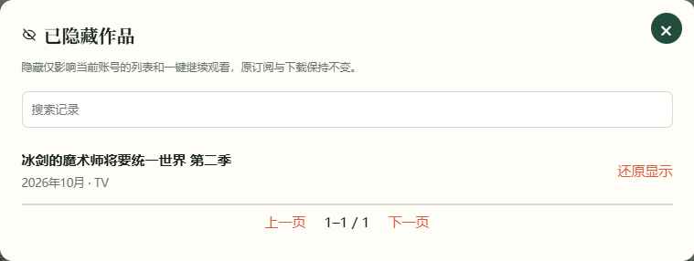
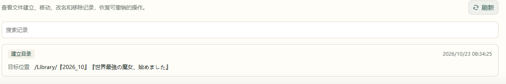

# 8. 日常管理

## 查找、筛选与隐藏

首页可切换卡片和表格，按年代、类型、资源来源和收藏状态筛选。**重置全部** 返回默认筛选；直接输入标题可查找被默认筛选或隐藏的作品。

在雷达或详情中将作品设为 **已隐藏**，它会从默认作品列表和雷达中移除。原有订阅、下载与观看记录保持不变。

要还原时，打开 **新作雷达 → 已隐藏作品**，找到作品并点击还原。

## 暂停、取消与删除订阅

在雷达的订阅状态菜单或作品详情中选择需要的操作：

| 操作 | 后续更新 | 已有文件 |
| --- | --- | --- |
| 暂停订阅 | 暂停自动获取，可恢复 | 保留 |
| 取消订阅（保留文件） | 停止订阅 | 保留 |
| 删除订阅（含文件） | 删除订阅 | 按确认页面删除对应文件 |
| 隐藏作品 | 原订阅继续运行 | 保留 |

涉及删除文件时，先核对确认窗口中的作品和操作范围，再确认。

## 建立订阅目录

本地收藏库已连接且可写时，雷达中的 **建立目录** 可为已订阅作品建立占位目录。已有目录继续使用，之后可在历史记录中查看结果。

## 设置收藏库休眠时段

1. 打开 **设置 → 连接 → 本地收藏库**。
2. 勾选 **启用每日休眠时段**，设置开始与结束时间。
3. 核对页面显示的运行设备时间，保存设置。

时段以运行 AnimeMachine 的设备时间为准，支持跨午夜。休眠期间暂停访问本地收藏库，保留已知状态；Ani-RSS 与其它媒体来源继续按各自的可用情况工作。

这项设置控制 AnimeMachine 对本地库的访问。其它应用仍可能使用同一块磁盘；磁盘是否实际休眠也取决于 NAS 和其它服务。

## 查看历史记录与日志

**设置 → 历史记录** 查看已执行的整理、目录及下载操作；**设置 → 日志** 查看运行提示。可先选择警告与错误，再按作品名称或关键字搜索。

