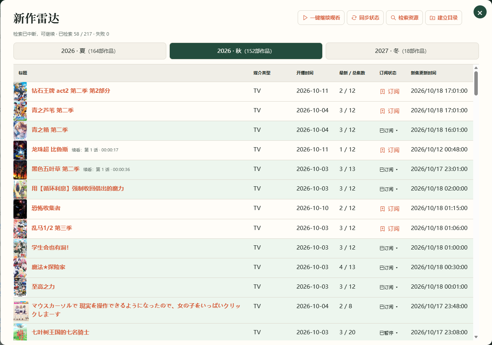
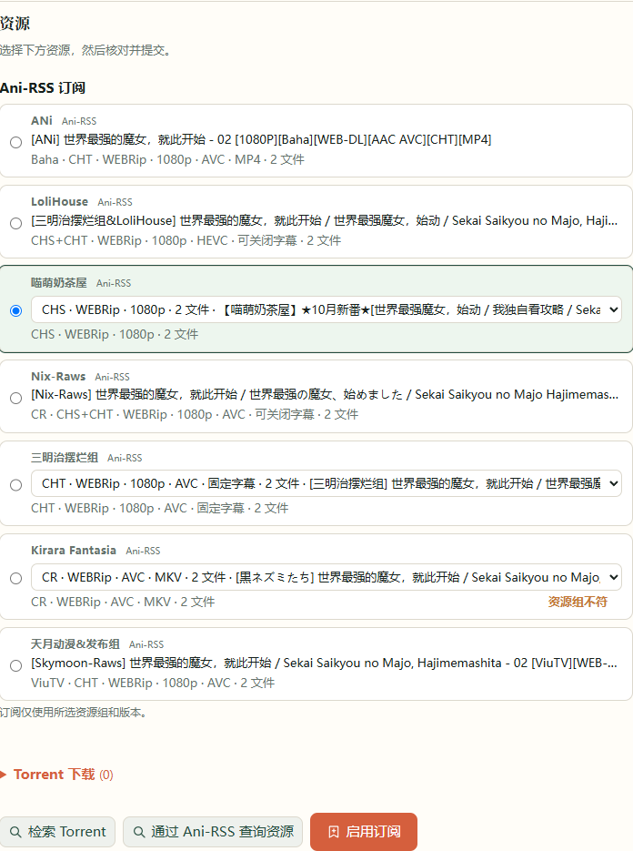
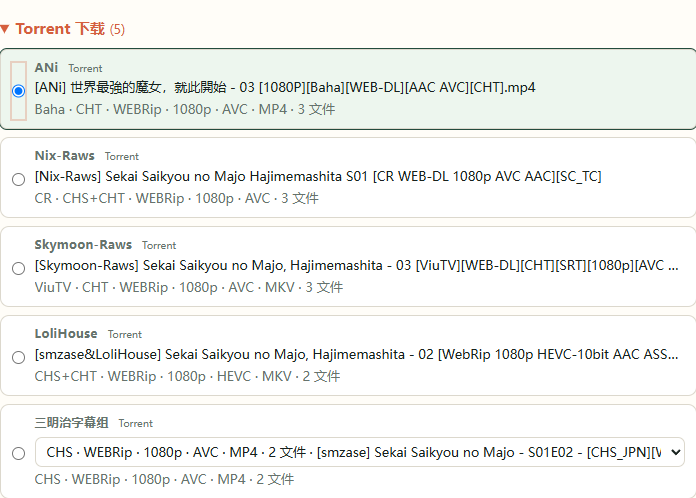

# 4. 订阅与下载

本章介绍资源选择、订阅与下载。Ani-RSS 订阅会继续跟踪后续更新；Torrent 下载则提交当前选定的资源。

## 找到作品

1. 在首页 **标题 / 别名** 输入作品名称，或打开 **新作雷达**。
2. 在雷达中选择对应季度，点击作品标题，打开详情。
3. 查看 **Ani-RSS** 资源区；需要刷新时点击资源检索按钮。

雷达中的 **同步状态** 获取 Ani-RSS 已知的订阅与媒体状态；**检索资源** 逐部查询该季度作品。检索在后台进行，进度会显示在页面上。

## 选择 Ani-RSS 资源

1. 选择一个字幕组。
2. 同组有多个版本时，用下拉框核对字幕、平台和画质，例如简体 / 繁体、Baha 等。
3. 选中需要的资源，点击 **启用订阅**，在订阅确认页面核对资源组与版本，再次点击 **启用订阅**。
4. 等待状态变为 **已订阅**，下载完成后在作品详情的播放区查看集数。

**完成标志：** 作品显示已订阅，已有媒体的集数出现在播放区。后续新集由 Ani-RSS 继续获取，AnimeMachine 同步显示状态。

资源旁的“语言不符”“画质不符”等说明来自当前偏好。确实需要该版本时，可选择强行订阅，并在确认页面核对不符项目。

## 尚未开播或等待收藏资源

在作品详情点击 **资源跟踪**，选择 **提前订阅连载**，保存后显示为 **待资源**。后台会定期检索，找到符合偏好的资源后自动启用 Ani-RSS 订阅；尚未连接 Ani-RSS 时，意向仍会保留。

默认使用设置中的资源组偏好。需要进一步限定时，取消勾选这一项，展开目标资源组，例如只勾选 **Kirara Fantasia → Baha**。已经存在的 Ani-RSS 订阅按原配置保留。

等待 BDRip 等收藏资源时，选择 **跟踪收藏资源**。发现资源后只提示，再由你核对版本并下载。所有记录可在新作雷达的 **资源跟踪** 中查看、调整或停止。

## 使用 Torrent 资源

1. 先在 **设置 → 连接** 确认 qBittorrent 可用。
2. 在作品详情点击 **检索 Torrent**，等待查询完成。
3. 展开 **Torrent** 结果，选择字幕组，再选择该组的字幕、画质等版本。
4. 点击 **预览下载计划**，核对作品、文件和目标目录后确认提交。
5. 打开 qBittorrent，选中刚加入的停止任务并开始下载。

本地 Torrent 计划以停止状态加入下载器，开始后才实际下载。连载作品会核对季度和集数，过滤串季、缺集及明显落后的资源；已完结作品与剧场版保留补收藏用途。

上百集的连载作品按每个版本最近 24 集的连续性检查，最多允许落后最新进度一集，避免要求一次找齐全部历史集数。收藏类版本仍可用于分批补全旧集。

## 使用自己的 Torrent 池

在 **设置 → 连接 → Torrent Collector** 中，作品检索和资源池可以分别使用：

| 使用方式 | 配置方法 |
| --- | --- |
| 临时找一部作品 | 在详情点击 **检索 Torrent**；无需单独运行采集器 |
| 已经维护了 `.torrent` 文件目录 | 填写 **Torrent 池路径**，启用 **定时扫描资源池** |
| 自动补充种子池 | 联合部署 Torrent Collector，并启用 **自动采集 Torrent** |

只使用现成种子池时，可以关闭自动采集，保留定时扫描。三种方式共用资源偏好，结果都在作品详情选择；文件清单与下载目录在提交前确认。

## 下载还没有开始

先在 AnimeMachine 查看连接与任务状态，再到 qBittorrent 查看该任务是否有可连接的做种者。资源已经提交但暂时没有速度，与“尚未提交下载”是不同状态。[常见问题](troubleshooting.md#download)列出了检查顺序。
