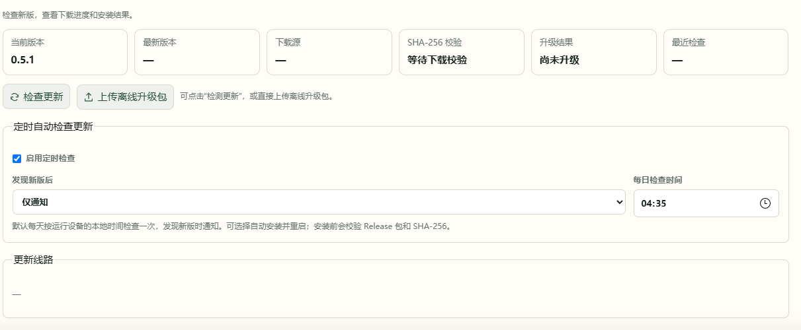

# 9. 更新与备份

更新 AnimeMachine 程序会保留原有设置、作品资料与观看记录。Bangumi Archive 是作品资料底包，与程序版本分别更新。

## 在线更新

1. 打开 **设置 → 检查更新**。
2. 点击检查，查看新版本与更新说明。
3. 根据页面可用的升级操作确认安装，等待程序重启并刷新页面。
4. 核对页面版本号。Docker 中使用镜像重新部署也可以完成更新。

## 上传离线升级包

0.5.1 起可在同一页面上传离线升级包：

1. 在可以下载文件的设备上取得匹配当前部署方式的 `.anm-update.zip`。
2. 在 **设置 → 检查更新** 选择文件并上传。
3. 等待校验、安装与重启，刷新后核对版本。



| 当前部署 | 使用的升级包 |
| --- | --- |
| Windows 发布包 | `AnimeMachine-版本-windows.anm-update.zip` |
| Docker | `AnimeMachine-版本-docker.anm-update.zip` |

普通 `release-windows.zip` 用于完整解压安装，Docker 的 `tar.gz` 是离线镜像；它们与上传入口使用的升级包用途不同。文件不匹配或校验失败时，当前可用版本继续运行。

## Docker 0.5.0 升到 0.5.1

正式发布的离线镜像可在 [Releases](https://github.com/kyupi-git/animemachine/releases/latest) 下载，文件名中的 `amd64` 对应 Intel / AMD，`arm64` 对应 ARM。

0.5.0 还没有上传入口，可先从本地镜像升级：

1. 把 `AnimeMachine-0.5.1-docker-linux-amd64.tar.gz` 上传到 NAS。该文件用于 Intel / AMD；ARM 设备选择对应架构的镜像。
2. 在终端导入镜像：

```sh
docker load -i AnimeMachine-0.5.1-docker-linux-amd64.tar.gz
```

3. 在项目目录的 `.env` 中设置 `ANM_IMAGE=animemachine:0.5.1`；使用默认完整组合时，同样设置 `TORRENT_COLLECTOR_IMAGE=animemachine:0.5.1`。
4. 在该目录运行 `docker compose up -d --pull never`，刷新并核对版本。

自定义 Compose 若直接写了镜像地址，则修改相应服务的 `image` 值。目录挂载、环境配置和数据目录继续使用原值。

## 电脑上手动替换发布包

停止旧程序，将新版解压到新目录，再把旧目录中的 `config.json`、`.env.local`（如有）和整个 `data` 目录复制到新目录，启动新版。媒体放在独立目录时，保持原路径可访问。

## 备份需要保留什么

停止 AnimeMachine 后备份设置与 `data`，媒体按自己的备份方式保存。

| 部署方式 | 备份内容 |
| --- | --- |
| 电脑 | `config.json`、`.env.local`（如有）、`data` |
| Docker | `compose.yaml`、`.env`（如有）、`config`、`data`，以及自定义的挂载配置 |

恢复时使用同一套目录映射和账户数据。目录中的 `initial-admin.txt`、服务密码文件属于账户信息，随备份妥善保存。
