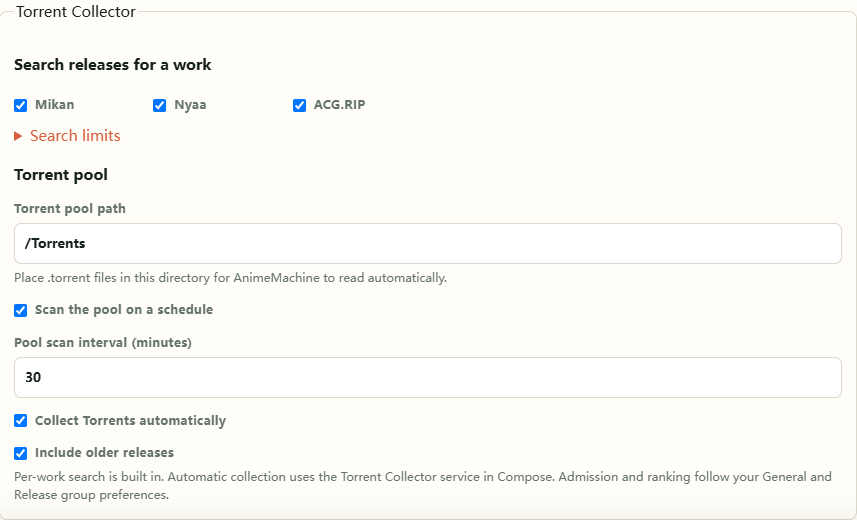

[中文](reference.md) | [English](reference.en.md) | [日本語](reference.ja.md)<br>
[README](../README.en.md) · [Usage guide](guide.en.md) · [Architecture](architecture.en.md)

# Configuration and technical reference

This reference covers deployment options, network configuration, data maintenance, and development entry points. Everyday settings are available in the interface; see the [usage guide](guide.en.md) for steps.

<a id="environment"></a>

## Configuration files and environment variables

| Installation | Configuration location |
| --- | --- |
| Local release | `config.json` and `.env.local` in the extracted folder |
| Source checkout | Root `config.json` and `.local/.env.local`; default state is `.local/state` |
| Docker Compose | `.env` beside `compose.yaml`, plus mounted `config/config.json` |

Launchers create the initial configuration. Save regular settings in the interface. Edit the environment file and restart to change launch ports, mounts, or service addresses. Explicit deployment values take precedence over interface settings. Keys are stored in server credential files; deployment credentials can also use Secret files.

Common Compose variables are listed below. Path variables specify **host folders**; paths inside containers follow the Compose mounts.

| Variable | Default / purpose |
| --- | --- |
| `ANM_IMAGE` | `ghcr.io/kyupi-git/animemachine:0.5.1` |
| `ANM_LIBRARY_DIR` | `./library`, collected media |
| `ANM_TORRENT_POOL_DIR` | `./torrents`, Torrent pool |
| `ANM_EXTERNAL_LIBRARY_DIR` | `./external/read-only`, existing media |
| `ANM_ANI_RSS_MEDIA_DIR` | `./external/ani-rss`, Ani-RSS media |
| `ANM_CONFIG_DIR`, `ANM_DATA_DIR` | `./config`, `./data`, settings and state |
| `ANM_IMPORTS_DIR` | `./imports`, manually downloaded Archive files |
| `PUID`, `PGID` | `1000`; set these to the user and group IDs used to access media |
| `ANM_SYNC_INTERVAL_MINUTES` | `30`, background sync interval |
| `ANM_ANI_RSS_URL`, `ANM_ANI_RSS_MODE` | Ani-RSS address and `prefer` / `fallback` / `manual` mode |
| `ANM_PUBLIC_URL` | An AnimeMachine address reachable from your viewing devices |

Full examples: [local installation](https://github.com/kyupi-git/animemachine/blob/main/deploy/local/.env.local.example) · [standalone Compose](https://github.com/kyupi-git/animemachine/blob/main/deploy/compose/templates/01-animemachine-standalone/.env.example) · [external downloader](https://github.com/kyupi-git/animemachine/blob/main/deploy/compose/templates/02-animemachine-external-qbt/.env.example) · [managed downloader](https://github.com/kyupi-git/animemachine/blob/main/deploy/compose/templates/03-animemachine-managed-qbt/.env.example) · [full stack](https://github.com/kyupi-git/animemachine/blob/main/deploy/compose/templates/04-full-stack/.env.example).

<a id="ports"></a>

### Addresses and ports

Local releases listen on `0.0.0.0:8787` by default. To use 8788, add `ANM_WEB_PORT=8788` to `.env.local`, restart, and open `http://localhost:8788`.

Compose uses `ANM_WEB_PORT` for the host port; the container still uses 8787. `ANM_BIND_ADDRESS` controls the host's published address. Set it to `127.0.0.1` for local access. Authentication is configured for the access scope, and the initial account is saved in `data/state/auth/initial-admin.txt`.

<a id="service-access"></a>

### qBittorrent / Ani-RSS web interfaces

Managed Compose interfaces are available on the LAN by default. New deployments generate separate passwords:

| Service | Address | Username | Initial password file in the project folder |
| --- | --- | --- | --- |
| qBittorrent | `http://YOUR-NAS-ADDRESS:8080` | `admin` | `config/qbittorrent/.animemachine/web-password` |
| Ani-RSS | `http://YOUR-NAS-ADDRESS:7789` | `admin` | `config/ani-rss/.animemachine/web-password` |

You can also read the passwords from the folder containing `compose.yaml`:

```sh
docker compose exec animemachine cat /QbtConfig/.animemachine/web-password
docker compose exec animemachine cat /AniRssConfig/.animemachine/web-password
```

Upgrades keep existing accounts and passwords. If you changed a password inside a service, use that password. Older Ani-RSS installations still using the initial `admin` password can set a separate password in Security settings. For access from the host only, set `QBT_BIND_ADDRESS` and `ANI_RSS_BIND_ADDRESS` to `127.0.0.1` in `.env`, then run `docker compose up -d`.

Those addresses are for browsers. Services within Compose use `http://qbittorrent:8080` and `http://ani-rss:7789`. Use `host.docker.internal` for host services; a custom Linux Compose setup needs the matching `host-gateway` entry.

## Network, proxies, and certificates

Metadata and covers use official sources, mirrors, and available proxies according to connection health. **Settings → Diagnostics** shows routes and errors. Source options are under **Settings → Connections → Metadata network & mirrors**.

In the full stack, AnimeMachine checks the Mikan homepage, public RSS feeds, Torrent metadata, and public Bangumi metadata in the background. It selects validated sources and periodically checks whether the official source has recovered. Public Mikan feed URLs in existing subscriptions follow the selected source, retaining groups and progress. External Ani-RSS instances and manually changed sources are left under user control. A configured Bangumi token keeps the official API; tokens are never sent to mirrors.

To use a proxy, add settings such as these to your environment file:

```dotenv
HTTP_PROXY=http://host.docker.internal:7890
HTTPS_PROXY=http://host.docker.internal:7890
NO_PROXY=localhost,127.0.0.1,qbittorrent,ani-rss
```

For a local installation, substitute your actual proxy address. Keep local service names in `NO_PROXY` so LAN connections remain direct.

<a id="ANM_CA_BUNDLE"></a>

For an enterprise or private CA, put its file in the configuration folder, for example `config/certs/custom-ca.pem`, and set `ANM_CA_BUNDLE=/Config/certs/custom-ca.pem` in Docker. For a local installation, use its actual path. Certificate validation and Archive's official SHA-256 verification apply to every route.

## Metadata, collection, and background tasks

Archive import accepts official `dump-*.zip` files. Select one in Settings or place it in `imports` before launch. Initial setup, weekly updates, and manual updates share validation and merge behavior.

Scheduled checks use **UTC+8**: Thursday at 02:12, with one Friday 02:12 follow-up if no new archive is available, then the next weekly cycle. Convert from UTC+8 for your local time. Progress and recent results are persisted in runtime state.

The full Compose stack includes the resource collector. It is also available as a [standalone collector configuration](https://github.com/kyupi-git/animemachine/blob/main/deploy/compose/advanced/collector/compose.yaml). See the [advanced environment example](https://github.com/kyupi-git/animemachine/blob/main/deploy/compose/advanced/collector/.env.example) for sources, history scans, retries, and proxies. The collector writes to the Torrent pool; AnimeMachine scans it and submits downloads from confirmed plans.

### Torrent Collector settings

Everyday options are under **Settings → Connections → Torrent Collector**. Per-work search is built into AnimeMachine and becomes available after connecting qBittorrent. Automatic collection runs in the persistent Compose Collector service.



| Setting | Default and purpose |
| --- | --- |
| `components.torrentCollector.search.sources` | `mikan`, `nyaa`, `acgrip`: per-work search providers |
| `components.torrentCollector.search.maxResults` | `80`: maximum Torrent metadata files saved per search |
| `components.torrentCollector.search.timeoutSeconds` | `120`: search time limit in seconds |
| `components.torrentCollector.pool.monitorEnabled` | `true`: scan the pool every `components.discovery.pollMinutes` |
| `components.torrentCollector.pool.collectionEnabled` | `true`: add releases automatically; manual per-work searches remain available when off |
| `components.torrentCollector.pool.historyEnabled` | `true`: collect older releases; new releases are still collected when off |

The Collector shares your resource preferences and picks up changes automatically. Existing Torrent and media files remain in place. Manual search also shows candidates whose preferences can be overridden explicitly.

## Data files and maintenance

Important locations inside the state folder:

| Location | Content |
| --- | --- |
| `catalog/anime-catalog.sqlite3` | Title metadata, names, people, relationships, and query indexes |
| `catalog/runtime.sqlite3` | Runtime data for local resources, media, and service syncs |
| `metadata/archive`, `metadata/cache` | Archive files and cached metadata |
| `auth` | Accounts, login state, and initial credentials |
| `history` | Recoverable backups for file changes |

Back up the complete configuration and state folders to preserve this data. Stop the service before copying them, and use one instance per state folder. Set permissions by purpose: writable collection and state, readable external media, and a Torrent pool writable by the collector.

## Source installation and development

Source installations use Python 3.11+. Download the repository and run `scripts/windows/AnimeMachine.cmd`, `scripts/unix/AnimeMachine-Linux.sh`, or `scripts/unix/AnimeMachine-macOS.command` for your system. The launcher creates the environment and installs dependencies.

| Code location | Responsibility |
| --- | --- |
| [catalog](https://github.com/kyupi-git/animemachine/tree/main/src/animemachine/catalog) | Archive import, title queries, relationships, metadata updates |
| [torrents](https://github.com/kyupi-git/animemachine/tree/main/src/animemachine/torrents) | Identification, collection, completeness, candidate ranking |
| [integrations](https://github.com/kyupi-git/animemachine/tree/main/src/animemachine/integrations) | qBittorrent, Ani-RSS, playback, subtitles |
| [library](https://github.com/kyupi-git/animemachine/tree/main/src/animemachine/library) | Media scans, folder plans, history restoration |
| [web](https://github.com/kyupi-git/animemachine/tree/main/src/animemachine/web) | Web interface, translations, styles, interactions |
| [scripts](https://github.com/kyupi-git/animemachine/tree/main/scripts) | Checks, builds, releases, launchers |

Run `python scripts/test_all.py` for project checks and `python scripts/check_quality.py` for quality checks. See [Contributing](../CONTRIBUTING.md) before working on changes.

The Release workflow prepares one seasonal cover bundle for all platforms. For a local release build, run `python scripts/build_cover_pack.py` before the platform build script.
