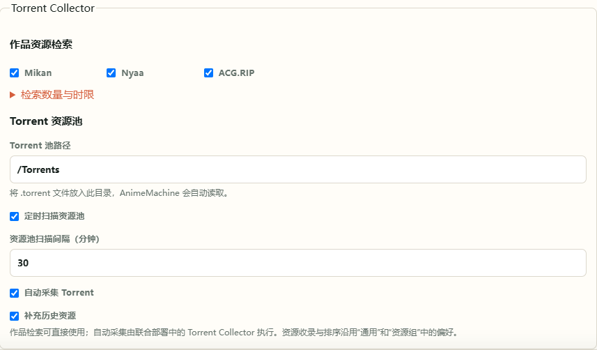

[中文](reference.md) | [English](reference.en.md) | [日本語](reference.ja.md)<br>
[README](../README.md) · [使用指南](guide.md) · [架构说明](architecture.md)

# 配置与技术参考

本页提供部署参数、网络配置、数据维护和开发入口的参考说明。常规设置可在界面中完成，操作步骤见[使用指南](guide.md)。

<a id="environment"></a>

## 配置文件与环境变量

| 部署方式 | 配置位置 |
| --- | --- |
| 本地发布包 | 解压目录中的 `config.json`、`.env.local` |
| 从源码运行 | 根目录的 `config.json`、`.local/.env.local`；状态默认在 `.local/state` |
| Docker Compose | `compose.yaml` 同目录的 `.env`，以及挂载的 `config/config.json` |

启动器会生成初始配置。在界面中保存常规设置；需要调整启动端口、挂载目录或服务地址时，再编辑环境文件并重启。部署环境中的显式值优先于界面配置。密钥在服务器凭据文件中保存；部署时提供的密钥也可以使用 Secret 文件。

Compose 常用变量如下。路径变量指定**宿主机目录**，容器内路径仍以 Compose 挂载为准。

| 变量 | 默认值 / 用途 |
| --- | --- |
| `ANM_IMAGE` | `ghcr.io/kyupi-git/animemachine:0.5.0` |
| `ANM_LIBRARY_DIR` | `./library`，收藏库 |
| `ANM_TORRENT_POOL_DIR` | `./torrents`，Torrent 池 |
| `ANM_EXTERNAL_LIBRARY_DIR` | `./external/read-only`，已有媒体 |
| `ANM_ANI_RSS_MEDIA_DIR` | `./external/ani-rss`，Ani-RSS 媒体 |
| `ANM_CONFIG_DIR`、`ANM_DATA_DIR` | `./config`、`./data`，设置和状态 |
| `ANM_IMPORTS_DIR` | `./imports`，手动导入的 Archive 文件 |
| `PUID`、`PGID` | `1000`；设为运行容器、访问媒体的用户与组 ID |
| `ANM_SYNC_INTERVAL_MINUTES` | `30`，后台同步间隔 |
| `ANM_ANI_RSS_URL`、`ANM_ANI_RSS_MODE` | Ani-RSS 服务地址与 `prefer` / `fallback` / `manual` 调用模式 |
| `ANM_PUBLIC_URL` | 其他播放设备能访问的 AnimeMachine 地址 |

完整示例：[本地配置](https://github.com/kyupi-git/animemachine/blob/main/deploy/local/.env.local.example) · [独立 Compose](https://github.com/kyupi-git/animemachine/blob/main/deploy/compose/templates/01-animemachine-standalone/.env.example) · [外部下载器](https://github.com/kyupi-git/animemachine/blob/main/deploy/compose/templates/02-animemachine-external-qbt/.env.example) · [托管下载器](https://github.com/kyupi-git/animemachine/blob/main/deploy/compose/templates/03-animemachine-managed-qbt/.env.example) · [完整组合](https://github.com/kyupi-git/animemachine/blob/main/deploy/compose/templates/04-full-stack/.env.example)。

<a id="ports"></a>

### 地址与端口

本地发布包默认监听 `0.0.0.0:8787`。要改用 8788，在 `.env.local` 中写入 `ANM_WEB_PORT=8788`，重新启动，访问 `http://localhost:8788`。

Compose 的 `.env` 也使用 `ANM_WEB_PORT` 调整宿主机端口，容器内仍是 8787。`ANM_BIND_ADDRESS` 控制宿主机发布地址；本机使用可以设为 `127.0.0.1`。应用按访问范围建立登录配置，初始账户写入 `data/state/auth/initial-admin.txt`。

<a id="service-access"></a>

### qBittorrent / Ani-RSS 管理页面

托管 Compose 的管理页面默认可从局域网访问，首次部署自动生成独立密码：

| 服务 | 地址 | 用户名 | 初始密码文件（项目目录内） |
| --- | --- | --- | --- |
| qBittorrent | `http://NAS地址:8080` | `admin` | `config/qbittorrent/.animemachine/web-password` |
| Ani-RSS | `http://NAS地址:7789` | `admin` | `config/ani-rss/.animemachine/web-password` |

也可以在保存 `compose.yaml` 的目录运行以下命令查看：

```sh
docker compose exec animemachine cat /QbtConfig/.animemachine/web-password
docker compose exec animemachine cat /AniRssConfig/.animemachine/web-password
```

升级沿用原账号和密码；在服务内修改密码后，以修改后的密码为准。旧版 Ani-RSS 仍使用 `admin` 初始密码时，可在其安全设置中改为独立密码。仅需本机访问时，在 `.env` 将 `QBT_BIND_ADDRESS`、`ANI_RSS_BIND_ADDRESS` 设为 `127.0.0.1`，再运行 `docker compose up -d`。

以上地址用于浏览器访问。Compose 内的服务连接使用 `http://qbittorrent:8080`、`http://ani-rss:7789`。连接宿主机服务可使用 `host.docker.internal`；Linux 自定义 Compose 需配置对应的 `host-gateway` 映射。

## 网络、代理与证书

作品资料与封面会按连接健康情况选择官方来源、镜像和可用代理。当前线路及错误可在 **设置 → 诊断** 中查看；来源配置位于 **设置 → 连接 → 元数据网络与镜像**。

完整组合由 AnimeMachine 在后台检查蜜柑首页、公开 RSS、Torrent 元数据和 Bangumi 公开资料，自动选择通过校验的来源，并定期检查官方来源是否恢复。已有订阅中的公开蜜柑地址随来源迁移，字幕组与进度保持不变。自行连接的 Ani-RSS 以及用户手动更改的来源不参与自动切换。设置了 Bangumi 令牌时保留官方 API，令牌不会发送给镜像。

使用代理时，在环境文件中设置，例如：

```dotenv
HTTP_PROXY=http://host.docker.internal:7890
HTTPS_PROXY=http://host.docker.internal:7890
NO_PROXY=localhost,127.0.0.1,qbittorrent,ani-rss
```

本地运行时将代理地址换成本机实际代理。`NO_PROXY` 中保留本地服务地址，让局域网连接直接进行。

<a id="ANM_CA_BUNDLE"></a>

使用企业或自建证书时，将 CA 文件放入配置目录，例如 `config/certs/custom-ca.pem`，Docker 中设置 `ANM_CA_BUNDLE=/Config/certs/custom-ca.pem`。本地运行则填写证书的实际路径。证书验证与 Archive 文件的官方 SHA-256 校验在所有线路上生效。

## 资料、采集与后台任务

Archive 导入支持官方 `dump-*.zip`。可通过设置页选取文件，也可放入 `imports` 后启动。首次建库、周更新和手动更新复用同一套校验与合并流程。

定时检查采用 **UTC+8**：每周四 02:12 检查，上游未发布新版时于周五 02:12 补查一次，再进入下周周期。时区转换时以 UTC+8 为基准。任务进度与近期结果保存在运行状态中。

资源采集器由完整 Compose 组合提供，也可使用[独立采集器配置](https://github.com/kyupi-git/animemachine/blob/main/deploy/compose/advanced/collector/compose.yaml)。来源、历史扫描、重试和代理参数见[高级环境示例](https://github.com/kyupi-git/animemachine/blob/main/deploy/compose/advanced/collector/.env.example)。采集器写入 Torrent 池，AnimeMachine 扫描其内容，再按用户确认的计划提交下载任务。

### Torrent Collector 设置

日常选项位于 **设置 → 连接 → Torrent Collector**。单作品检索内置于 AnimeMachine，连接 qBittorrent 后即可使用；自动采集由 Compose 中的常驻采集器运行。



| 配置项 | 默认值与用途 |
| --- | --- |
| `components.torrentCollector.search.sources` | `mikan`、`nyaa`、`acgrip`，单作品检索来源 |
| `components.torrentCollector.search.maxResults` | `80`，每次检索最多保存的 Torrent 元数据数量 |
| `components.torrentCollector.search.timeoutSeconds` | `120`，检索时限，秒 |
| `components.torrentCollector.pool.monitorEnabled` | `true`，按 `components.discovery.pollMinutes` 定时扫描资源池 |
| `components.torrentCollector.pool.collectionEnabled` | `true`，自动补充资源池；关闭后仍可手动检索作品 |
| `components.torrentCollector.pool.historyEnabled` | `true`，采集历史资源；关闭后仍采集新发布资源 |

采集器共用资源偏好，设置变更后自动读取；已有 Torrent 和媒体文件保留。单作品检索也展示可手动覆盖偏好的候选。

## 数据文件与维护

运行状态目录中的主要内容如下：

| 位置 | 内容 |
| --- | --- |
| `catalog/anime-catalog.sqlite3` | 作品资料、名称、人员、关系及查询索引 |
| `catalog/runtime.sqlite3` | 本地资源、媒体与服务同步的运行覆盖数据 |
| `metadata/archive`、`metadata/cache` | Archive 文件与缓存资料 |
| `auth` | 账户、登录状态和初始凭据 |
| `history` | 文件调整的可恢复备份 |

备份整个设置与状态目录，可以一并保留这些数据。直接复制前先停止服务；同一份状态目录由一个实例使用。媒体权限按用途配置：收藏库和状态目录可写，外部媒体可读，采集器可写 Torrent 池。

## 源码运行与开发入口

源码环境使用 Python 3.11+。下载仓库后运行对应系统的 `scripts/windows/AnimeMachine.cmd`、`scripts/unix/AnimeMachine-Linux.sh` 或 `scripts/unix/AnimeMachine-macOS.command`，启动器会建立环境并安装依赖。

| 代码位置 | 负责的内容 |
| --- | --- |
| [catalog](https://github.com/kyupi-git/animemachine/tree/main/src/animemachine/catalog) | Archive 导入、作品查询、关系与资料更新 |
| [torrents](https://github.com/kyupi-git/animemachine/tree/main/src/animemachine/torrents) | 资源识别、采集、完整性与候选排序 |
| [integrations](https://github.com/kyupi-git/animemachine/tree/main/src/animemachine/integrations) | qBittorrent、Ani-RSS、播放与字幕 |
| [library](https://github.com/kyupi-git/animemachine/tree/main/src/animemachine/library) | 媒体扫描、目录规划和历史恢复 |
| [web](https://github.com/kyupi-git/animemachine/tree/main/src/animemachine/web) | Web 界面、三语文字、样式与交互 |
| [scripts](https://github.com/kyupi-git/animemachine/tree/main/scripts) | 检查、构建、发布与启动工具 |

开发检查使用 `python scripts/test_all.py`；质量检查使用 `python scripts/check_quality.py`。参与修改前请阅读[贡献说明](../CONTRIBUTING.md)。

正式发布由 Release 工作流统一准备当季封面包。本地构建时，先运行 `python scripts/build_cover_pack.py`，再运行对应系统的构建脚本。
